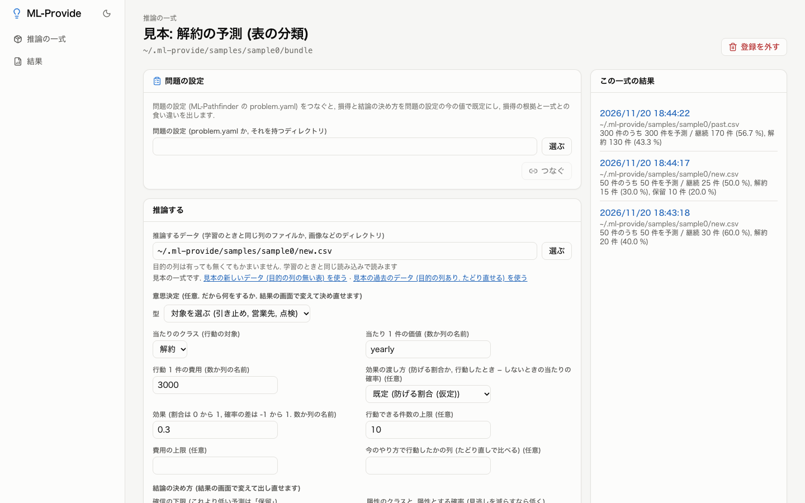

# ML-Provide

学習したモデルで新しいデータを推論し, 予測から結論と「だから何をするか」を出すローカルの Web アプリ.

「機械学習を全て GUI 上で行う」のうち「推論」の段階の画面で, [ML-Inference](https://github.com/victor-von-pooh/ML-Inference) を動かす. 推論の一式 (モデルの定義, 学習した重み, 前処理) は, [ML-Fathom](https://github.com/victor-von-pooh/ML-Fathom) で書き出したデータセット, [ML-CreateArchitecture](https://github.com/victor-von-pooh/ML-CreateArchitecture) で組んだモデルの定義, [ML-Found](https://github.com/victor-von-pooh/ML-Found) の実験から画面で作れる.


<table>
  <tr>
    <td></td>
    <td></td>
  </tr>
  <tr>
    <td></td>
    <td></td>
  </tr>
  <tr>
    <td></td>
    <td></td>
  </tr>
</table>

画面の例は, 「見本の一式を入れる」で入る見本 (作り方の分かる合成のデータで, その場で学習した小さなモデル). 一番上と予測の表は解約の予測の新しいデータ 50 行, たどり直しは解約の予測の過去のデータ 300 行, 量を決めるのは日々の売上の先の 7 日, 列の効きは来店数の予測の新しいデータ. 方策は, 方策の骨組みの学習が実験の中に書き出した CartPole の方策の一式を「実験の一覧から登録」で登録したもの. 置き場のパスは既定の `~/.ml-provide` で示している.

## できること

- **推論の一式**: 学習の結果 (モデルの定義, データセット, 実験のディレクトリか重み) から作るか, ML-Inference の `make_bundle` で作った一式を場所で登録するか, 問題の設定の段階 (ML-Pathfinder) で問題に記録した学習のプロジェクトの実験の一覧から選んで登録する. 試すだけなら見本の一式を入れる. ML-Studio の中では, 上の帯で選んだ問題で実験と一式の一覧を絞り (「全ての一式を出す」で外せる), 学習の結果から作る一式にその問題をつなぐ
- **推論**: 学習のときと同じ列のファイル, 画像などのディレクトリ, 音声のファイルかディレクトリ, 画面に書いた文を推論する. 時系列の一式は何段も先まで予測できる. 実験の一覧から登録した表と時系列の一式は, 学習に使ったデータセットのテスト用の分割を場所を入れずに選んで推論できる
- **結論**: 判断の内訳, まとめる列ごとの表, 結論の文, 予測の表. 結論の決め方 (保留にする確信, 陽性とする確率, 値の帯, まとめる列) を変えて, 推論し直さずに出し直す. CSV で持ち出す
- **意思決定**: 量を決める, 対象を選ぶ, 振り分けるの型で, 損得と制約から行ごとの行動と前提を出す. 過去のデータでたどり直して, 素朴なやり方と実際の得を比べる
- **結果どうしの比べ**: 同じ一式か同じ入力の結果を選んで, 結論, 判断の内訳, 意思決定の得と損を並べ, 違う決め方や列を目立たせる. 同じ群分けの一式の結果は, 群ごとの件数と割合 (学習のときと結果 1 からの差) と列の特徴を並べ, 増えた群と減った群を見る
- **外れ方の確かめ**: 一式の予測の外れ方の記録が実績に当たっているかを確かめ, 測り直して一式に書き戻す
- **列の効き**: どの列が予測を動かしているかを, 列を並べ替えて推論し直して求める. 選んだ 1 行についても, 列ごとにその行の値が予測を上げたか下げたかと理由の文を出す
- **問題とのつなぎ**: [ML-Pathfinder](https://github.com/victor-von-pooh/ML-Pathfinder) の problem.yaml をつなぐと, 意思決定と結論の決め方の既定がその損得になる. 今のやり方 (前の週の同じ曜日と同じ量など) も既定になり, 列を足さずにたどり直しで比べられる. 守る指標 (欠品の率など) も, たどり直しでこの方針で数えて守る線と比べる
- 列の予測でない一式 (領域, 点群, ベクトル, 画像, 文を出す一式) は, 1 件ごとの出力を絵や散布図で見て `.npy` で持ち出す
- ML-EDA のファイルの組のデータセット (画像と領域, 撮影と点群. 中身の手順をかけた版 3 も) で学習した結果からも一式を作り, 新しい画像の領域と, 新しい撮影から予測した元の座標の点群を見る
- ML-EDA の音声のデータセット (版 1. 周波数, チャンネル, 長さをそろえる中身の手順も) で学習した結果からも一式を作り, 新しい音声のファイルかディレクトリを分類や回帰で推論する. WAVE の他に FLAC, MP3, Ogg, AIFF も読む
- 学習しない既製のモデル (torchvision の学習済みの ResNet18 など) は, 出どころ, モデル, 重みを選んで一式を作る. 作る前に種類の数, 前処理, ライセンスの警告を下見し, 画像のファイルかディレクトリから種類の名前と確信度を出す. 問題をつなぐと結論の決め方が既定になり, 決めておいた重みと違えば知らせる
- 拡散やフローの生成のモデルは, データセットを使わずに実験から雑音だけの一式を作り, 件数と種から生成する. 繰り返しの手順, 出力の形, 入力が複数のモデルの入力ごとの出どころも画面で選ぶ
- 表を作る拡散のモデル (ML-Quest の表の生成の骨組みの学習が実験の中に作る, 列の符号化を写した一式) は, 実験の一覧から登録し, 件数と種から列の名前と型のある表を作って CSV で持ち出す
- **並べる (推薦)**: 利用者と品物の 2 塔のモデルの並べるの一式 (ML-Quest の並べるの骨組みの学習が実験の中に作る) を実験の一覧から登録し, 書いた利用者か利用者の表のファイルから, 利用者ごとの上位 K 件の品物と点数を見る. 件数 K (既定は一式の件数) と, 前に反応した品物を除くかを選べ, 並べられなかった利用者は理由が出る. 正解の反応の表を渡すと Recall@K と NDCG を数える
- **似た写真を探す**: 学習しない既製のモデルの埋め込みで, 登録した写真 (索引) から問いの写真に見た目の近い写真を返す検索の一式 (ML-Quest の似た写真を探す骨組みの `bundle.py` が作る) を場所で登録し, 問いの写真のファイルかディレクトリと返す件数 K (既定は一式の件数) を渡すと, 問いごとに近い順の写真 (縮小画像, 種類, 余弦の近さ) と 1 件の問いの待ち時間が並ぶ. 待ち時間の上限 (守る指標) を超えた問いの数と, 骨組みの評価 (Recall@K, NDCG@K と写真を縮めた画素をそのまま並べたものとの差) も見る
- **群分け (まとめる)**: 表の行の埋め込みと群の中心の群分けの一式 (ML-Quest のまとめるの骨組みの実験から ML-Inference で作る) を登録し, 新しい行を最も近い群に割り当てる. 群ごとの件数, 割合 (学習のときとの比べ), 列ごとの特徴の群の要約, 群の中心に近い行 (代表の行. 件数を選べる), 学習のときより群の中心から遠い行 (学習の表を渡して作った一式) と, 学習の群の安定性 (調整ランド指数, シルエット係数と比べる相手との差) を見て, 群ごとの行に絞って確かめる. 写真を既製の埋め込みで群に分けた一式 (学習しない) も同じに登録し, 出どころ (モデルと重み), ライセンスの警告と群 (群の代表の写真は縮小画像で並ぶ) を見る (群に分けた写真を渡して作った一式は, 群の中心から遠い写真にも印が付く)
- **異常の検知**: 正常の行が多い表の行ごとに異常の度合いを出す一式 (ML-Quest の異常の検知の骨組みの実験から ML-Inference で作る) を登録し, 度合いの分布 (学習用の正常の行との比べ), 度合いの上位の行, 実験の上位 K 件の適合率と PR-AUC を見る. 度合いの高い順に人が確かめる件数の上限までの行を人の確かめに回し, 確かめた人の名前を書いて 1 件ずつ「異常」か「正常」を付けると, 判断が結果の隣の記録に貯まり, 一覧で見られる
- **効果の見積もり**: 処置 (クーポンなど) を無作為に配った記録から顧客ごとの効果 (配ったときの結果 − 配らないときの結果) を学んだ一式 (ML-Quest の効果の見積もりの骨組みの実験から ML-Inference で作る) を登録し, 効果の分布 (学習用の行との比べ), 効果の上位の行, 実験の Qini の係数と上位 30 % などの効果の差, Qini の曲線 (でたらめに配る線と並べる) を見る. 配る数の上限を決めて推論すると, 効果の高い順に上限までの配る行の一覧が出る
- **値段を変える判断**: 試しに値段を変えた売れ行きの記録から, 値段を入力に入れて売れた数を予測する一式 (ML-Quest の値段を変える判断の骨組みの実験から ML-Inference で作る) を登録し, 値段の候補 (今の値段に対する変える割合) と変える幅の上限を決めて推論すると, 行ごとに上限の中で見込みの利益が最も大きい値段を選ぶ. 選んだ値段と変える割合の一覧, 選んだ値段と今の値段の見込みの利益の比べ, 上限を超える候補の方が利益の大きい行の数, 弾力性の分布, 実験の売れた数の誤差と利益の差と比を見る
- **時間をまたぐ量の判断**: 商品ごとの日ごとの売れた数の記録から, 先の期間の需要を分位点で予測する一式 (ML-Quest の時間をまたぐ量の判断の骨組みの実験から ML-Inference で作る) を登録し, 品切れの損, 売れ残りの損, 発注の数の上限を決めて推論すると, 商品ごとに損の比から決まる水準 τ の分位点から在庫を引いた数を上限の中で発注する. 商品ごとの発注の数の一覧, 見込みの損と前の期間と同じ数を発注したときの見込みの損の比べ, 上限に当たった商品の数, 需要の分位点の幅, 実験の需要の誤差と分位点の損失と損の差と比を見る
- **強化学習の方策**: 方策の一式を場所か実験の一覧から登録し, 観測を入れて, 守りを当てた行動と守りの結果 (そのまま, 範囲に収めた, 止めた, 元の制御に戻したなど) と理由を見る. 観測のファイル (CSV か `.npy`) でまとめて決め, 守りの結果ごとの件数と 1 件ずつの表を残して CSV で持ち出す

## 使い方

### 必要なもの

- [uv](https://docs.astral.sh/uv/) (Python は uv が用意する. 3.10 以上)
- Node.js 24 以上と [pnpm](https://pnpm.io/) 11 以上 (`corepack enable` で `package.json` の版が入る)

### 導入と起動

```bash
git clone --recursive https://github.com/victor-von-pooh/ML-Provide.git
cd ML-Provide
make setup   # submodule, Python と Node.js の依存 (PyTorch を含む. 初めては数分かかる)
make serve   # 画面をビルドして http://127.0.0.1:8769 で起動 (Ctrl+C で止める)
```

起動すると `ML-Provide を開く: http://127.0.0.1:8769/api/auth?token=...` の行が出るので, その URL をブラウザで開く (トークンは起動ごとに変わる. 決まったトークンにする場合は環境変数 `ML_PROVIDE_TOKEN`). ポートは `make serve PORT=8800` のように変えられる.

開いたら「見本の一式を入れる」を押し, 見本の一式の画面で「見本の新しいデータを使う」→「推論する」で試せる.

画面は API を使って動くが, API は画面のためのもので, スクリプトから推論する場合は ML-Inference を直接使う.

## 文書

- [操作ガイド](docs/GUIDE.md): 画面の順の操作ガイド (自分の一式の作り方, 意思決定, 起動の設定). 最後の章が「困ったとき」
- [設計](docs/DESIGN.md): 今の設計と決まり (ML-Inference と ML-Quest との約束, 画面, API, 用語, 置き場, 安全)
- [TODO](TODO.md): まだやっていないこと (優先度の順)

## 開発

```bash
make dev-backend    # API (変更を自動で読み直す. 開く URL を出す)
make dev-frontend   # 画面 (別の端末で)
make check          # lint, 型検査, テスト
cd frontend && pnpm e2e   # 画面の通しのテスト
```

README と操作ガイドの画面の例 (`docs/images/`) は, 画面の通しのテストと同じ見本で撮る. `cd frontend && pnpm build` の後, `bash e2e/screens.sh` で起動し, 別の端末の `frontend` で `node e2e/screens.ts` を実行する.

| ディレクトリ | 内容 |
| --- | --- |
| `backend/` | API (Python, FastAPI). ML-Inference を呼び, 登録した一式と結果を保存する |
| `frontend/` | 画面 (TypeScript, React, Vite) |
| `ML-Inference/` | submodule (推論のライブラリ) |
| `ML-Quest/` | submodule (problem.yaml を読むため) |
| `docs/` | 操作ガイド, 設計, README の画面の例 (`images/`) |

## ライセンス

[MIT](LICENSE)
