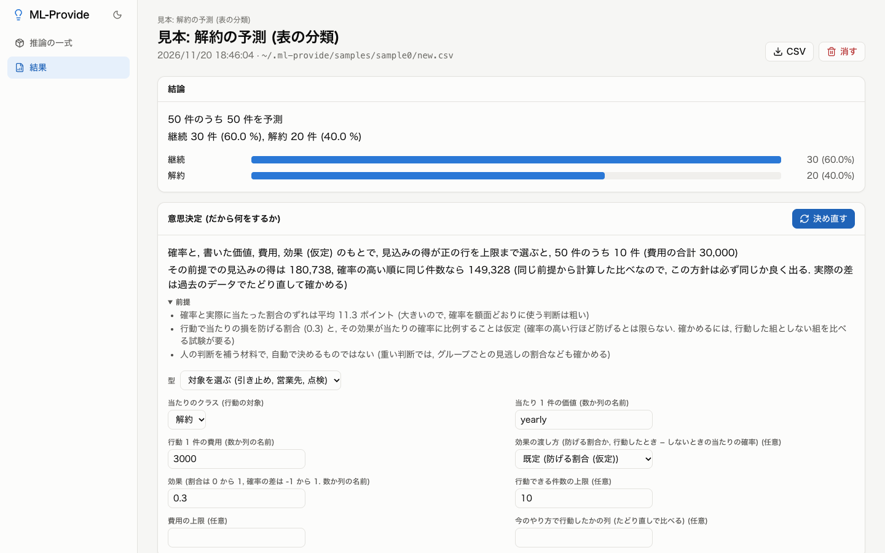
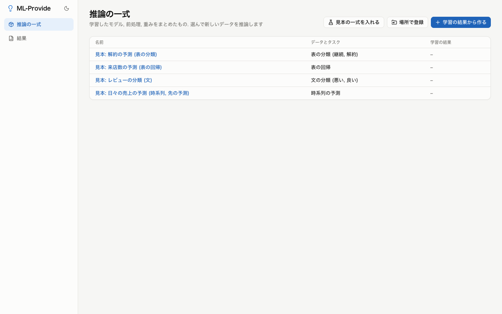
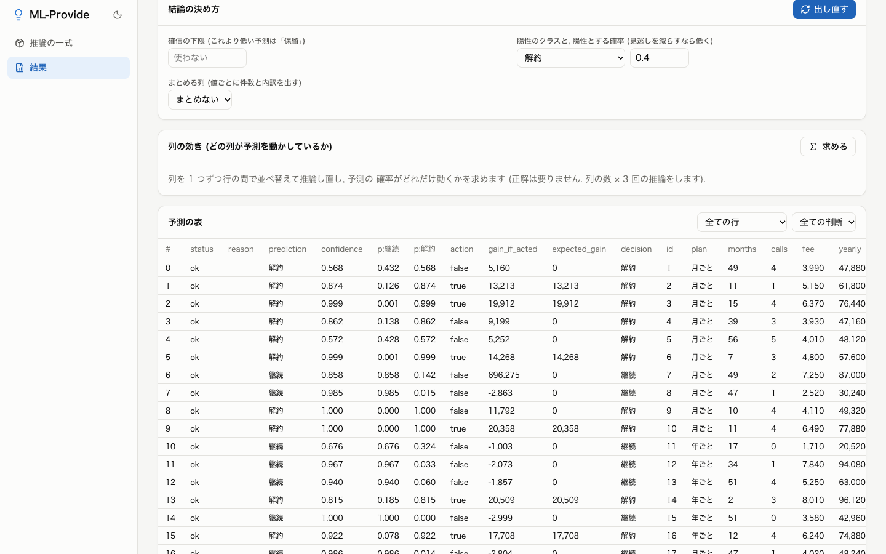
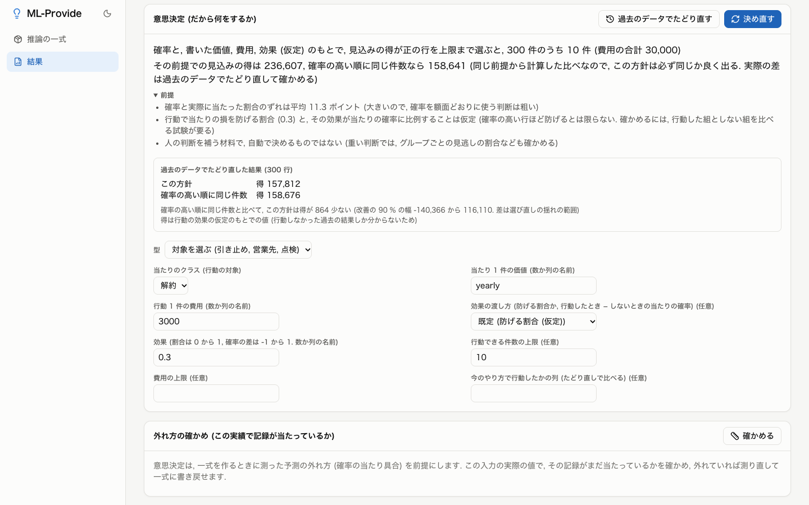
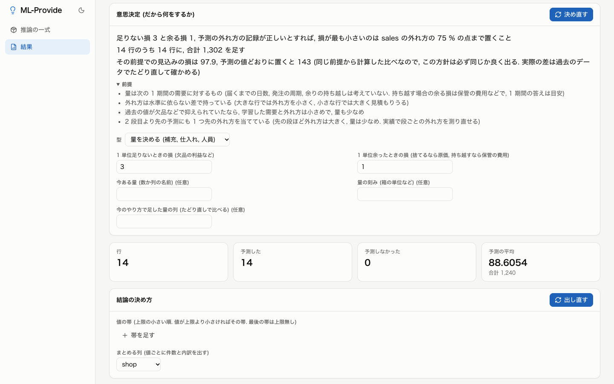
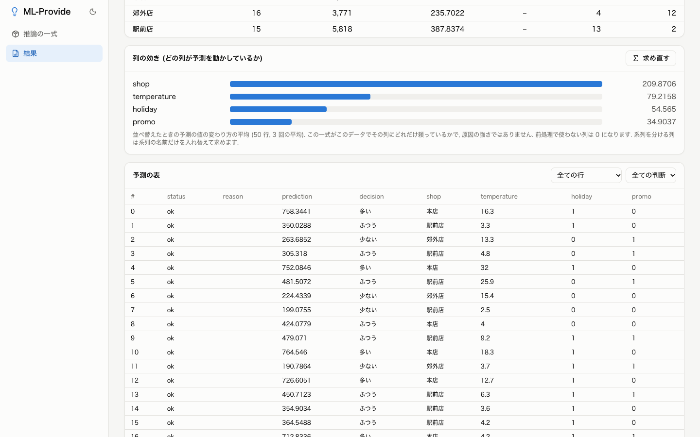

# ML-Provide

学習したモデルで新しいデータを推論し, 予測から結論と「だから何をするか」を出すローカルの Web アプリ.

「機械学習を全て GUI 上で行う」のうち「推論」の段階の画面で, [ML-Inference](https://github.com/victor-von-pooh/ML-Inference) を動かす. 推論の一式 (モデルの定義, 学習した重み, 前処理) は, [ML-Fathom](https://github.com/victor-von-pooh/ML-Fathom) で書き出したデータセット, [ML-CreateArchitecture](https://github.com/victor-von-pooh/ML-CreateArchitecture) で組んだモデルの定義, [ML-Found](https://github.com/victor-von-pooh/ML-Found) の実験から画面で作れる.



<table>
  <tr>
    <td></td>
    <td></td>
  </tr>
  <tr>
    <td></td>
    <td></td>
  </tr>
  <tr>
    <td></td>
    <td></td>
  </tr>
</table>

画面の例は, 「見本の一式を入れる」で入る見本 (作り方の分かる合成のデータで, その場で学習した小さなモデル). 一番上と予測の表は解約の予測の新しいデータ 50 行, たどり直しは解約の予測の過去のデータ 300 行, 量を決めるのは日々の売上の先の 7 日, 列の効きは来店数の予測の新しいデータ. 置き場のパスは既定の `~/.ml-provide` で示している.

## できること

- **推論の一式**: 学習の結果 (モデルの定義, データセット, 実験のディレクトリか重み) から作るか, ML-Inference の `make_bundle` で作った一式を場所で登録する. 試すだけなら見本の一式を入れる
- **推論**: 学習のときと同じ列のファイル, 画像などのディレクトリ, 画面に書いた文を推論する. 時系列の一式は何段も先まで予測できる
- **結論**: 判断の内訳, まとめる列ごとの表, 結論の文, 予測の表. 結論の決め方 (保留にする確信, 陽性とする確率, 値の帯, まとめる列) を変えて, 推論し直さずに出し直す. CSV で持ち出す
- **意思決定**: 量を決める, 対象を選ぶ, 振り分けるの型で, 損得と制約から行ごとの行動と前提を出す. 過去のデータでたどり直して, 素朴なやり方と実際の得を比べる
- **外れ方の確かめ**: 一式の予測の外れ方の記録が実績に当たっているかを確かめ, 測り直して一式に書き戻す
- **列の効き**: どの列が予測を動かしているかを, 列を並べ替えて推論し直して求める
- **問題の設定とのつなぎ**: [ML-Pathfinder](https://github.com/victor-von-pooh/ML-Pathfinder) の problem.yaml をつなぐと, 意思決定と結論の決め方の既定がその損得になる
- 列の予測でない一式 (領域, 点群, ベクトル, 画像, 文を出す一式) は, 1 件ごとの出力を絵や散布図で見て `.npy` で持ち出す

## 使い方

必要なもの: [uv](https://docs.astral.sh/uv/) (Python は uv が用意する. 3.10 以上), Node.js 24 以上と [pnpm](https://pnpm.io/) 11 以上 (`corepack enable` で `package.json` の版が入る).

```bash
git clone --recursive https://github.com/victor-von-pooh/ML-Provide.git
cd ML-Provide
make setup   # submodule, Python と Node.js の依存 (PyTorch を含む. 初めては数分かかる)
make serve   # 画面をビルドして http://127.0.0.1:8769 で起動 (Ctrl+C で止める)
```

起動すると `ML-Provide を開く: http://127.0.0.1:8769/api/auth?token=...` の行が出るので, その URL をブラウザで開く (トークンは起動ごとに変わる. 決まったトークンにする場合は環境変数 `ML_PROVIDE_TOKEN`). ポートは `make serve PORT=8800` のように変えられる.

開いたら「見本の一式を入れる」を押し, 見本の一式の画面で「見本の新しいデータを使う」→「推論する」で試せる.

- [操作ガイド](docs/GUIDE.md): 画面ごとの手順, 自分の一式の作り方, 意思決定, 起動の設定 (自作の手順と部品, モデルを覚える数), 置き場
- [設計](docs/DESIGN.md): 方針, API, 一式と問題の設定の版の扱い, 次の段階

画面は API を使って動くが, API は画面のためのもので, スクリプトから推論する場合は ML-Inference を直接使う.

## 開発

```bash
make dev-backend    # API (変更を自動で読み直す. 開く URL を出す)
make dev-frontend   # 画面 (別の端末で)
make check          # lint, 型検査, テスト
cd frontend && pnpm e2e   # 画面の通しのテスト
```

| ディレクトリ | 内容 |
| --- | --- |
| `backend/` | API (Python, FastAPI). ML-Inference を呼び, 登録した一式と結果を保存する |
| `frontend/` | 画面 (TypeScript, React, Vite) |
| `ML-Inference/`, `ML-Quest/` | submodule |
| `docs/` | 操作ガイドと設計 |

## ライセンス

MIT
