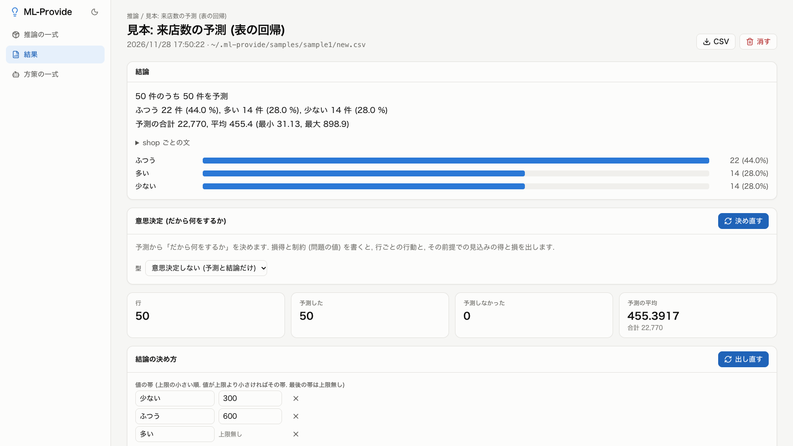
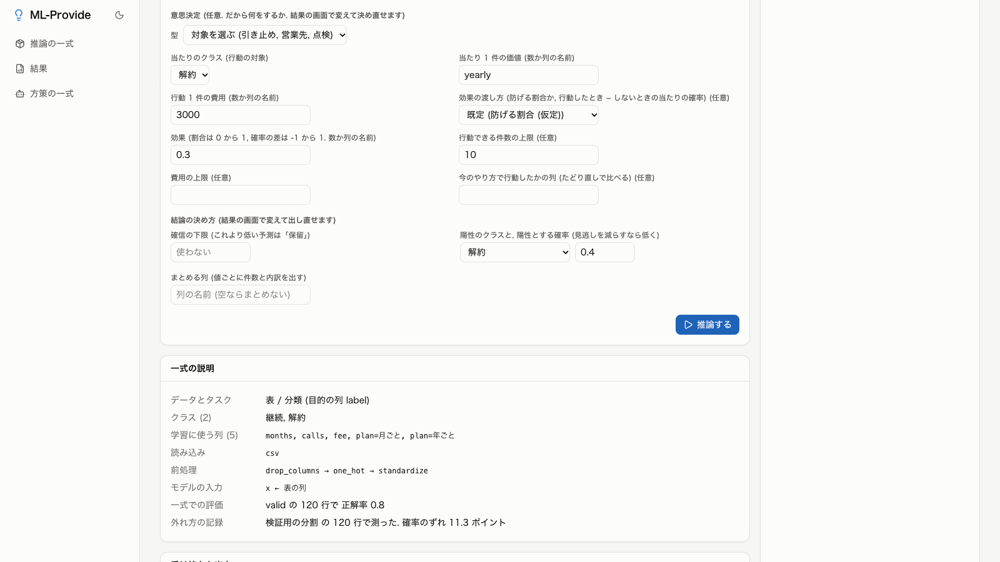

# ML-Provide 操作ガイド

ML-Provide の使い方を, 見本の一式を入れてから推論し, 結論と意思決定を見るまでの画面の順に説明する. 2 章から 8 章は, アプリが作る見本の一式で試せる (手元のモデルとデータは要らない. 6 章の「問題の設定の損得を使う」は ML-Pathfinder の見本も使う). 設計の方針と API は [DESIGN.md](DESIGN.md) を参照.

## 目次

0. [準備](#準備)
1. [起動する](#1-起動する)
2. [見本の一式を入れる](#2-見本の一式を入れる)
3. [推論する](#3-推論する)
4. [結果を見る](#4-結果を見る)
5. [結論の決め方を変えて出し直す](#5-結論の決め方を変えて出し直す)
6. [意思決定 (だから何をするか)](#6-意思決定-だから何をするか)
7. [どの列が予測を動かしているか](#7-どの列が予測を動かしているか)
8. [結果の一覧](#8-結果の一覧)
9. [列の予測でない一式](#9-列の予測でない一式)
10. [起動の設定](#10-起動の設定)
11. [置き場](#11-置き場)
12. [困ったとき](#12-困ったとき)

画像は見本の一式で撮ったもの. 置き場のパスは既定の `~/.ml-provide` で示している.

## 準備

この手順書でよく使う言葉.

| 言葉 | 意味 |
| --- | --- |
| 一式 | 推論の一式. 学習したモデルの定義と重み, 前処理 (データセットの説明とレシピ) をまとめたディレクトリ (`inference.yaml` を持つ) |
| 結論 | 予測から出す判断の内訳とまとめの文 |
| 結論の決め方 | 保留にする確信の下限, 陽性とする確率, 値の帯, まとめる列 |
| 意思決定 | 損得と制約から, 行ごとに何をするかを決めること |
| 外れ方 | 一式が記録した予測の外れ方. 意思決定の前提になる |

始める前に, ML-Provide を README の「導入と起動」の手順で導入しておく (`make setup`. PyTorch も入るので, 最初は数分かかる).

## 1. 起動する

ML-Provide はローカルで動く Web アプリ. 端末で起動して, 表示された URL をブラウザで開く.

1. ML-Provide を clone したディレクトリで `make serve` を実行する. 画面をビルドしてから `http://127.0.0.1:8769` で待ち受ける. 端末は使ったままになるので, 止めるまでそのままにする
2. 端末に `ML-Provide を開く: http://127.0.0.1:8769/api/auth?token=…` と出るので, その URL を開く. トークンは起動するたびに変わる
3. 「推論の一式」の画面が開けば準備完了

```bash
make serve
```

> **トークンを毎回同じにする**
> `ML_PROVIDE_TOKEN=好きな文字列 make serve` で起動すると, `http://127.0.0.1:8769/api/auth?token=好きな文字列` を開けば入れる.

## 2. 見本の一式を入れる

「推論の一式」の画面の「見本の一式を入れる」を押すと, 見本のデータで小さなモデルをその場で学習し, 4 つの一式を登録する (数秒). 見本のデータは, 作り方の分かる合成のデータ.

| 見本 | データ | 結論の決め方の既定値 |
| --- | --- | --- |
| 解約の予測 (表の分類) | 契約の種類, 利用した月数, 問い合わせの回数, 月額 → 解約か継続 | 「解約」の確率が 0.4 以上なら解約 (見逃しを減らす) |
| 来店数の予測 (表の回帰) | 店, 気温, 休日, 販促 → 来店数 | 300 人と 600 人で 3 つの帯に分け, 店ごとにまとめる |
| 日々の売上の予測 (時系列, 先の予測) | 2 つの店の日々の売上 (前の日と前の週の売上, 曜日) → 次の日の売上 | 店ごとにまとめる. 「何段も先まで予測する」で先の 7 日を予測できる |
| レビューの分類 (文) | 短いレビューの文 → 良いか悪い | 確率が 0.8 より低いものは保留 |


自分の一式を使う場合は, 次のどちらか.

- **学習の結果から作る**: モデルの定義, ML-EDA (ML-Fathom の画面) で書き出したデータセット, ML-Found の実験のディレクトリ (か重みのファイル) を選ぶ. 学習のスクリプトが前処理の外でしたこと (並びの先頭に足した番号, 目的の値の標準化) があれば, 畳んだ欄に書く (学習用の分割の平均と標準偏差で標準化した場合は, 選ぶだけで中心と幅を求める)
- **実験の一覧から登録**: ML-Pathfinder で骨組みを書き出した問題の設定のプロジェクトから, 学習が一式 (`inference`) を作った実験が新しい順に並ぶ. 「登録」を押すと, 場所を打たずに登録して一式の画面に移る. ML-Pathfinder の置き場を変えている場合は, ML-Provide も同じ環境変数 `ML_PATHFINDER_HOME` で起動する
- **場所で登録**: 学習のスクリプトが ML-Inference の `make_bundle` で作った一式 (`inference.yaml` を持つディレクトリ. 選ぶ対話では箱の印) を選ぶ

学習の結果から作るときの前提: モデルは, そのデータセットの前処理の後の値で, その定義から ML-ModelControl で組み立てて学習したもの (ML-Found で学習した実験をそのまま選べばよい). 重みは `state_dict`. 入力が 1 つのモデルは, 表なら学習に使う列, 画像, 文, 点群なら中身の配列を受け取る. 出力が複数のモデルは, 使う出力の名前を畳んだ欄に書く. 入力が複数のモデルは ML-Inference の `make_bundle` で作って, 場所で登録する. 作る前に学習用の見本を推論できることを確かめる. 定義のノードが外部の重みのファイル (`weights.path`) を持っていても作れる (学習した重みは全て実験の重みにあるので, 一式を作るときも推論するときも外部の重みのファイルは読まない).

ファイルの組のデータセット (ML-EDA の `export_image_masks` で書き出した画像と領域, `export_capture_clouds` で書き出した撮影と点群. 版 2 と版 3) を選ぶと, データセットの受け持ち, 正解, 項目, 件数が出る. 書き出しで中身の手順 (画像の大きさをそろえるなど) をかけた版 3 では, 項目ごとの手順も出る. 手順は一式に残り, 推論で新しい画像や撮影に同じ手順をかける. データセットを読めなければ理由が出て, 「作る」は押せない. 画像は 0 から 1 にして, 撮影は深度から点に戻して決まった数を選んでモデルに渡したもの (ML-Quest の骨組みの学習のスクリプトと同じ扱い) として作る. 入力が撮影か点群なら, 入力から選ぶ点の数を学習と同じ値で書く (確かめで正解から選ぶ点の数と点を選ぶ乱数の種は任意. 骨組みなら config の `data.input_points`, `data.target_points`, 種は `data.seed` + 1). 骨組みの学習は実験の中に一式 (`inference`) を作るので, 「実験の一覧から登録」でも使える.


## 3. 推論する

一式の名前を押すと, 一式の画面に移る. 左上が「推論する」, 下が「一式の説明」, 右が「この一式の結果」.


1. 「推論するデータ」に, 学習のときと同じ列のファイル (目的の列は有っても無くてもよい) か, 画像などのディレクトリを選ぶ. 見本の一式は「見本の新しいデータを使う」で, 推論を試すデータが入る (日々の売上の見本は, 2 店の過去の 30 日と売上の空の先の 7 日. 他は目的の列の無い 50 行). 文の一式は「文を書く」で, 1 行に 1 つの文を書いてもよい
2. 「結論の決め方」は一式の既定値が入っている. 変える場合は, 結果の画面でも出し直せる
3. 目的の列の過去の値を使う時系列の一式は「何段も先まで予測する」を選べる. 目的の列が空の先の行を, 予測した値を次の行の過去の値に使いながら系列ごとに順に予測する (結果は先の行だけで, 何段目かを `step` に出す. 先の段ほど誤りが積み重なる. 表の目的の列には予測した値が入る. 列の効きは求めない)
4. 「推論する」を押す

「一式の説明」の「一式での評価」は, 一式を作るときに検証用の分割を一式で推論した値. 実験の記録 (ML-Found の監視した指標のベストの値) と比べられる場合は, 合うかどうかも出る. 合わない場合は画面の上に注意が出る. 学習のスクリプトが前処理の外でしたことを一式に書き忘れると, 形は合っても予測が誤るため (見本の一式は学習の基盤を使わずに作るので, 実験の記録は無い).

## 4. 結果を見る

推論すると結果の画面に移る.


- **結論**: 何件を予測したか, 判断ごとの件数と割合の文と横棒. 予測できなかった行 (前処理の後に欠損がある, 文が空, レシピの手順で除く行など) は「予測なし」になり, 理由は表の `reason` の列に出る
- **数のタイル**: 行の数, 予測した数, 予測しなかった数, 判断の種類 (回帰は予測の平均と合計)
- **予測の表**: 元の列に, `status`, `reason`, `prediction`, `confidence` (分類の, 予測したクラスの確率), `p:<クラス>` (クラスごとの確率), `decision` (判断) を足した表. 予測した行か予測しなかった行か, 判断で絞れる


- 「CSV」で予測と判断の表を保存する (表計算のアプリで開ける BOM 付きの UTF-8)

## 5. 結論の決め方を変えて出し直す

「結論の決め方」を変えて「出し直す」を押すと, 推論し直さずに判断とまとめだけが変わる.

| 決め方 | タスク | 意味 |
| --- | --- | --- |
| 確信の下限 | 分類 | 予測したクラスの確率がこれより低い行を「保留」にする |
| 陽性のクラスと, 陽性とする確率 | 2 クラスの分類 | そのクラスの確率がこの値以上なら, そのクラスにする (見逃しを減らすなら低く). 確信の下限とは一緒に使えない |
| 値の帯 | 回帰, 予測 | 上限の小さい順に名前を付ける. 値が上限より小さければその帯. 最後の帯は上限無し |
| まとめる列 | 全て | 列の値ごとに, 件数と判断の内訳 (回帰は合計と平均も) を表にする |

下は, 解約の見本で陽性のクラスを外し, 確信の下限を 0.8 にして出し直し, 予測の表を「保留」で絞ったところ.


回帰の見本は, 値の帯の内訳と, 店ごとの合計, 平均, 帯の内訳が出る.



## 6. 意思決定 (だから何をするか)

予測を見て終わりにせず, 次の行動を決める. 推論の画面の「意思決定」で型を選び, 損得と制約 (課題の値. 店なら廃棄の損, 研究なら 1 件の処理時間, 遊びなら続けて遊ぶ時間) を書く. 見本の一式には既定の値が入っている (試すために置いた想定の値で, 課題から決めた値ではない).

| 型 | 書くこと | 出るもの |
| --- | --- | --- |
| 量を決める (補充, 仕入れ, 人員) | 1 単位足りないときの損, 余ったときの損, 今ある量, 刻み | 行ごとの足す量. 足りない損が余る損の 3 倍なら, 予測の外れ方の 75 % の点まで置く |
| 対象を選ぶ (引き止め, 営業先) | 当たりの価値 (列も可), 行動の費用, 効果 (行動で防げる割合 (仮定) か, 効果のモデルが出す 行動したとき − しないときの当たりの確率. 確率の差なら, 当たりを減らしたいか増やしたいか), 件数か費用の上限 | 行ごとに選ぶか. 確率 × 価値 × 効果 − 費用 (確率の差なら 価値 × 差 − 費用. 減らしたいときは差の符号を反転) の大きい順 |
| 振り分ける (人が確かめる) | 見逃しの損, 空振りの損, 回せる件数 | 行ごとに回すか. 損の比で決まる確率以上 |



結果の画面の「意思決定」に, 何をどれだけするかの文と, その前提が出る. 文は「書いた損得と予測の外れ方の記録が正しいとすれば」の形で, 同じ前提での素朴なやり方との比べは必ずこの方針が良く出る (前提から計算しただけ). 前提には, 量なら 1 期間の判断であること, 外れ方の当たり具合, 欠品で抑えられた過去の売上の影響, 選ぶなら効果が仮定であることなどが出る.

**実際に良いかは, 過去のデータでたどり直して確かめる.** 推論するデータに目的の列のある過去のデータ (見本では「見本の過去のデータを使う」) を選ぶと, 結果の画面の「過去のデータでたどり直す」で, この方針と素朴なやり方の実際の得と損と, その差の 90 % の幅が出る. 幅は行 (時刻でずらす一式は時刻) を選び直して求める. 幅が 0 をまたげば, 差は選び直しの揺れの範囲 (方針を変える根拠にならない).

下は解約の見本 (1 年分の料金を価値として, 10 人まで引き止める). この見本では, 価値で選んでも確率の高い順に選んでも, 実際の得の差は揺れの範囲だった. たどり直しは, 方針が効かない場合もそう示す.


日々の売上の見本は, 先の 7 日を予測して, 欠品の損 3, 売れ残りの損 1 で置く量を出す.


意思決定の型と損得は「決め直す」で変えられる (推論はし直さない). 型を「意思決定しない」にすると外れる.

### 問題の設定の損得を使う

問題の設定 ([ML-Pathfinder](https://github.com/victor-von-pooh/ML-Pathfinder)) で決めた損得を, 推論の既定にできる. 一式の画面の「問題の設定」で, problem.yaml (かそれを持つディレクトリ) を選んで「つなぐ」. 骨組みのプロジェクトで学習した一式なら, 一式の上のディレクトリにある問題の設定が候補に出るので「これをつなぐ」でよい. 実験の問題の設定は学習の時点の写しなので, 写しが元 (ML-Pathfinder の置き場) の場所を持てば, 元が候補に出る (「… が指す元の問題の設定です」). 元が無いと写しが候補に出て, ML-Pathfinder で直した損得が届かないと添えられる.

- つなぐと, 推論の「意思決定」と「結論の決め方」の既定が, 問題の設定の今の値になる (結論の決め方は, 一式の既定値に問題の設定のまとめる列を重ねる). 一式の画面の「問題の設定」に, 意思決定の文と損得の根拠が出る. 何段も先まで予測するかは, 推論の欄で選ぶ
- 一式と食い違う場合 (目的の列が違う, 分類の一式に量の意思決定, まとめる列や損得の列が一式の学習のデータに無いなど) は, その文が出る
- 問題の設定に今のやり方 (例: 前の週の同じ曜日と同じ量) を書いてあれば, 量を決める型の「今のやり方で足した量の列」の下に「空なので, 問題の設定の今のやり方 (7 期前の値と同じ量) で比べます」と出る. 過去のデータに今のやり方の列を足さなくても, 「過去のデータでたどり直す」で今のやり方と比べられる (前の期の値が無い始めの行は, どの方針でも数えない). 列を書けばその列で比べ, 「使わない」で外せる
- 問題の設定を ML-Pathfinder で直すと, 次にこの画面を開いたときから使う. 推論の画面で損得を変えても, 問題の設定には書き戻さない (その結果の決め方として残る)
- 問題の設定のファイルが消えたか, 別の問題の設定に置き換わった場合は理由が出て, 既定は一式の既定値に戻る. 「つなぎを外す」で外せる
- 推論の既定にできるのは, 受け持ちが表の列を予測する問題の設定だけ. 作る, 並べるなど他の受け持ちの問題の設定は, つなぐと「この問題の設定の受け持ち (作る, 正解の種類は画像) の推論の結論はまだ扱いません. 意思決定と結論の決め方は一式の既定値のままです」(括弧の中は受け持ちごと)と出て, 既定は一式の既定値のまま. 前の版 (版 1) の problem.yaml もそのままつなげる

試すには, ML-Pathfinder の「見本を開く」で「総菜の作る量」を開き, 5 の節で「使えるデータの列は」を date, shop, sales (1 行に 1 つ), 「系列を分ける列は」を shop, 6 の節で「予測の時点で分かっている列は」を shop にし, 「予測の時点では分からない列は」を空にする (確かめに「直す」が無くなるまで). 右上の「problem.yaml」で保存したファイル (ブラウザの保存先に入る) を, ML-Provide の「見本: 日々の売上の予測 (時系列, 先の予測)」の一式の画面の「問題の設定」で選んで「つなぐ」. 推論の欄の欠品の損が 3 から 200, 売れ残りの損が 1 から 150 に変わり, 根拠「欠品は粗利 200 円, 廃棄は原価 150 円」が出る. 列を合わせずにつなぐと, 「まとめる列 store が一式の学習のデータにありません」と出る.

### 外れ方の記録を確かめる

意思決定は, 一式を作るときに測った予測の外れ方 (分類は確率の当たり具合) を前提にする. 期間がずれると外れ方は変わる (検証用の期間で求めた 80 % の幅が, 後の期間では 80 % を覆わないことがある). 目的の列のある実績を推論した結果の画面で「確かめる」を押すと, 今の記録の幅がその実績をどれだけ覆ったかと, 測り直した幅が出る. 外れていれば「一式に書き戻す」で, これからの推論と決め直しはその外れ方を使う (一式の画面の「外れ方の記録」が「測り直した実績」になる). 書き戻すと登録した場所の `inference.yaml` を書き換えるので, 確認が出る. 一式の画面の「外れ方を作ったときの記録に戻す」で戻せる.


下は来店数の見本の過去のデータ. 今の記録の 80 % の幅は 83 % を覆ったので, ほぼ当たっている. 書き戻したら, 測った実績とは別の期間の実績でたどり直して確かめる (同じ行で測って確かめると良く見えすぎる).

何段も先まで予測して量を決める一式 (日々の売上の見本など) では, 段ごとの外れ方も測れる (1 週間分をまとめて発注する場面を想定して作った機能で, 課題から決めた場面ではない. 使うかは問題の設定で決める). 「何段先まで」に段の数 (1 週間分なら 7) を書き, 予測を始める時刻の列を選んでから確かめる. 実績の中で予測を始める日を段の数おきにずらしながら何段も先まで予測し, 段ごとの外れ方を測る. 書き戻すと, 何段も先の予測の量には, その段の外れ方を使う (先の段ほど外れ方が大きいので, 欠品の損が重い場合は量が多めになる. 効いたかは, 測った実績とは別の期間でたどり直して確かめる).

## 7. どの列が予測を動かしているか

結果の画面の「列の効き」の「求める」を押すと, 推論したデータの列を 1 つずつ行の間で並べ替えて推論し直し, 予測 (分類は予測したクラスの確率, 回帰は値) がどれだけ動くかを横棒で出す. 正解の無いデータでも求められる (表と時系列のファイルの結果だけ).

下は来店数の見本. 店の水準, 気温, 休日, 販促の順に効いていて, 見本のデータの作り方 (店ごとの水準, 25 度で最も多い気温, 休日 +30 %, 販促 +20 %) と合う.


効きは「この一式がこのデータでその列にどれだけ頼っているか」で, 原因の強さではない. 前処理で使わない列は 0 になる. 並べ替えると予測できなくなる行がある列は, その行の数も出る.

## 8. 結果の一覧

左の「結果」で, 全ての一式の結果を新しい順に見られる. 一式を消しても結果は残る. 結果の画面の「消す」で結果を消す.

## 9. 列の予測でない一式

ML-Inference の一式の版 3 と 4 で, 出力の形が領域, 点群, ベクトル, 画像, 文の一式は, 結論が推論した件数だけで, 結論の決め方と意思決定の欄は出ない. 結果の画面の予測の表で行を選ぶと, 1 件ごとの出力 (領域と画像は絵, 点群は散布図, ベクトルは形と最初の値) を見られ, `.npy` で持ち出せる.

ファイルの組のデータセットから作った一式 (版 4) は, 新しい画像のファイルかディレクトリ, 撮影のディレクトリかそれを並べたディレクトリ (か, 同じ中身の手順で書き出したファイルの組のデータセットのディレクトリ) を推論する. 版 3 から作った一式は, 大きさの違う画像にも書き出しと同じ手順をかけてから推論し, 領域を元の画像の大きさに戻して出す (データセットのディレクトリを推論した件は, データセットの大きさのまま). 領域は領域の値 (データセットの領域のファイルと同じ値) で出て, 凡例に値ごとの名前が付く. 点群は元の座標 (正規化の平行移動を戻した, 撮影の世界の座標) で出る. 読めない件は理由を付けて飛ばす.

## 10. 起動の設定

- **自作の手順**: 拡散のサンプリングのような繰り返しの手順を使う一式で, 研究の自作の手順を使う場合は, 手順を `ml_inference.register_procedure` で登録するモジュールを起動の設定に書く (`uv run ml-provide --procedures my_package.procedures` か, 環境変数 `ML_PROVIDE_PROCEDURES=my_package.procedures`. `,` で区切って複数). 書いたモジュールだけを起動のときに読み, 一式やファイルに書かれたコードは読まない. 登録簿に無い手順の一式は, 一式の画面でそう出る
- **自作の部品**: ML-ModelControl の `register_unit` で登録する部品を使う一式も同じく, 部品を宣言したモジュール (`UNITS` か `register_units(register)`. 書き方は ML-ModelControl の docs/DESIGN.md の「自作の部品のモジュール」) を起動の設定に書く (`uv run ml-provide --units my_package.units` か, 環境変数 `ML_PROVIDE_UNITS=my_package.units`. `,` で区切って複数). 読めないモジュールがあれば起動しない. 一式のモデルの定義に書かれた名前からは何も読み込まず, 登録されていない部品を使う一式は, 部品の名前と起動の設定への足し方が一式の画面, 登録, 画面で作る一式, 推論の誤りに出る. 読んだモジュールと部品は `/api/info` の `unit_modules` で分かる
- **覚えるモデルの数**: 推論に使う一式は組み立てたモデルごと 4 つまで覚えて使い回す. 大きなモデルでメモリが足りない場合は環境変数 `ML_PROVIDE_MODEL_CACHE=1` で減らす

## 11. 置き場

既定は `~/.ml-provide/` (環境変数 `ML_PROVIDE_HOME` で変えられる).

- `bundles.json`: 登録した一式
- `bundles/`: 「学習の結果から作る」で作った一式 (一式の画面の「消す」でファイルも消える)
- `samples/`: 見本 (学習用のデータ, データセット, 重み, 一式, 新しいデータ)
- `results/`: 結果 (`predictions.csv` と `result.yaml`)

元のデータ, データセット, 実験のディレクトリは書き換えない.

## 12. 困ったとき

| 症状 | 対処 |
| --- | --- |
| 画面を開いても読み込めない, 「トークンが違います」 | 端末に出た最新の URL (`/api/auth?token=…`) を開き直す. 起動し直すとトークンが変わる |
| ポート 8769 が使われている | `make serve PORT=8800` のように別のポートで起動する |
| 一式の画面に「手順 … は登録簿にありません」 | 自作の手順を使う一式. 手順を登録するモジュールを起動の設定 (`--procedures` か `ML_PROVIDE_PROCEDURES`) に足して起動し直す (10 章) |
| 登録されていない部品の誤り | 自作の部品を使う一式. 部品を宣言したモジュールを起動の設定 (`--units` か `ML_PROVIDE_UNITS`) に足して起動し直す (10 章) |
| 大きなモデルでメモリが足りない | 環境変数 `ML_PROVIDE_MODEL_CACHE=1` で, 覚えるモデルを 1 つにする (10 章) |
| 一式の画面の「一式での評価」が実験の記録と合わない | 学習のスクリプトが前処理の外でしたこと (並びの先頭に足した番号, 目的の値の標準化) を一式に書き忘れている. 作り直すときに畳んだ欄に書く (2 章) |
| 結果に「… の結果は, このアプリの ML-Inference (結果の形の版 … まで) では読めません」 | 新しい版の ML-Inference で書いた結果. ML-Provide を新しくする |
| アプリを止めたい | `make serve` を動かしている端末で Ctrl+C |
