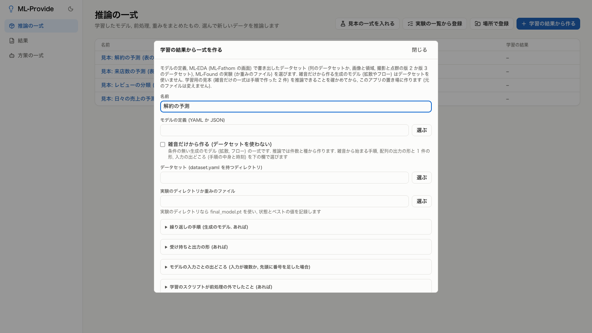
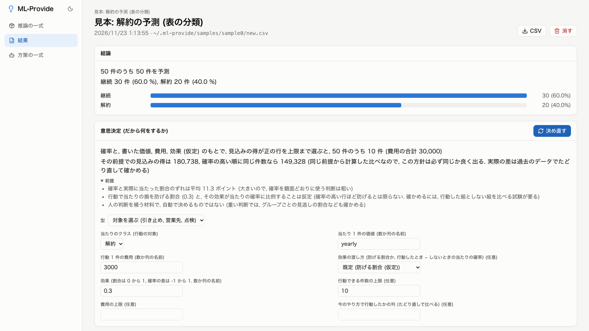
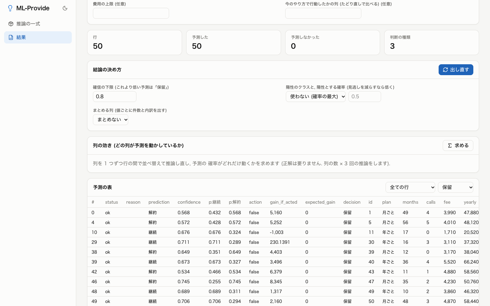
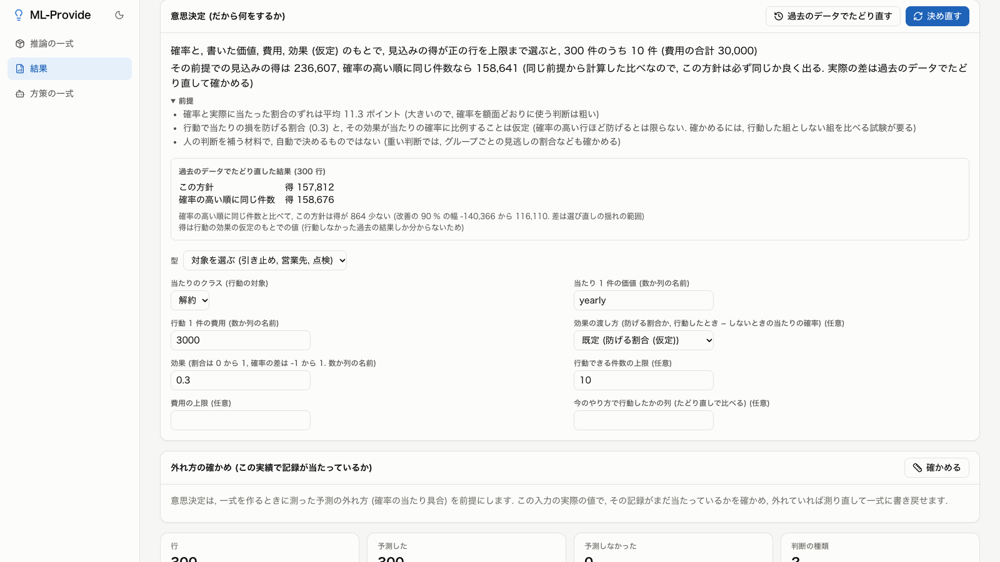
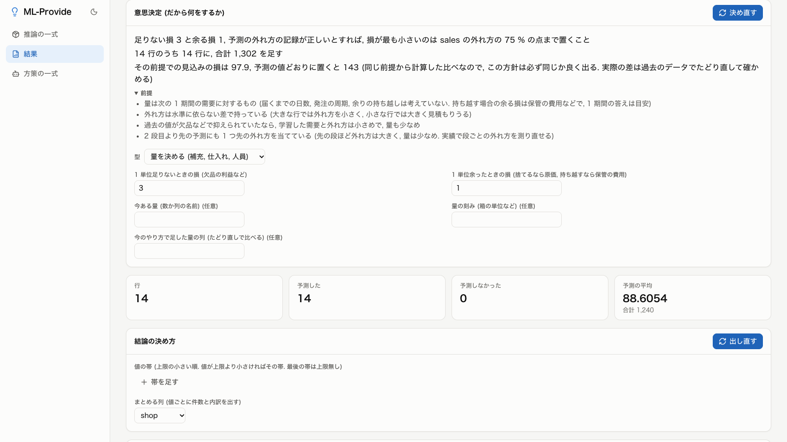
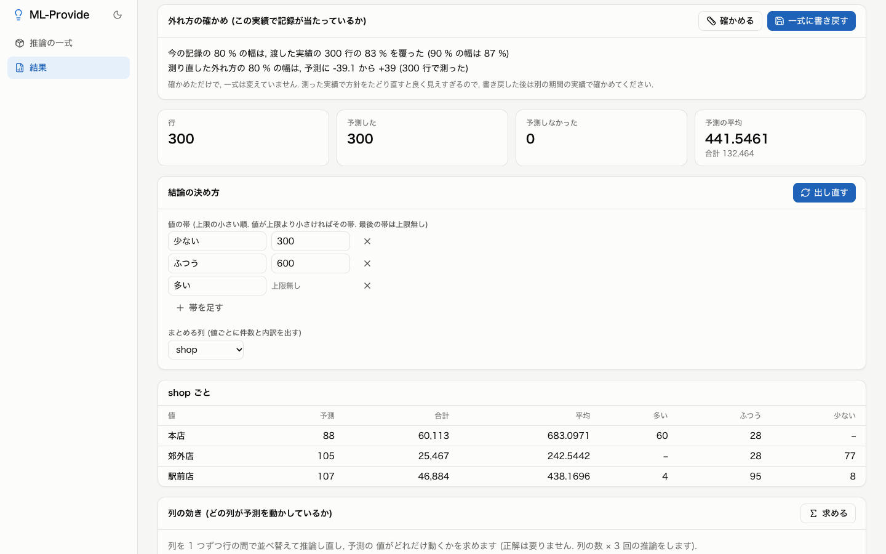
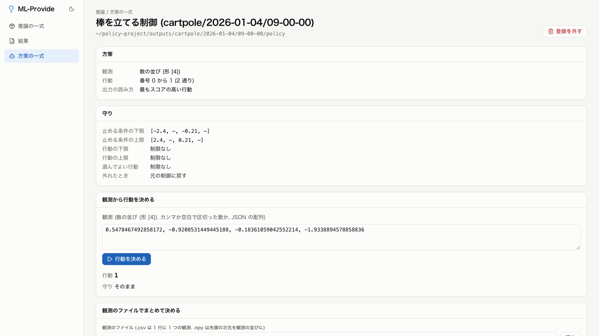

# ML-Provide 操作ガイド

ML-Provide の使い方を, 見本の一式を入れてから推論し, 結論と意思決定を見るまでの画面の順に説明する. 2 章から 9 章は, アプリが作る見本の一式で試せる (手元のモデルとデータは要らない. 6 章の「問題の設定の損得を使う」は ML-Pathfinder の見本も使う). 設計の方針と API は [DESIGN.md](DESIGN.md) を参照.

## 目次

0. [準備](#準備)
1. [起動する](#1-起動する)
2. [見本の一式を入れる](#2-見本の一式を入れる)
3. [推論する](#3-推論する)
4. [結果を見る](#4-結果を見る)
5. [結論の決め方を変えて出し直す](#5-結論の決め方を変えて出し直す)
6. [意思決定 (だから何をするか)](#6-意思決定-だから何をするか)
7. [どの列が予測を動かしているか](#7-どの列が予測を動かしているか)
8. [結果の一覧](#8-結果の一覧)
9. [列の予測でない一式](#9-列の予測でない一式)
10. [強化学習の方策](#10-強化学習の方策)
11. [起動の設定](#11-起動の設定)
12. [置き場](#12-置き場)
13. [困ったとき](#13-困ったとき)

画像は見本の一式で撮ったもの. 置き場のパスは既定の `~/.ml-provide` で示している.

## 準備

この手順書でよく使う言葉.

| 言葉 | 意味 |
| --- | --- |
| 一式 | 推論の一式. 学習したモデルの定義と重み, 前処理 (データセットの説明とレシピ) をまとめたディレクトリ (`inference.yaml` を持つ) |
| 結論 | 予測から出す判断の内訳とまとめの文 |
| 結論の決め方 | 保留にする確信の下限, 陽性とする確率, 値の帯, まとめる列 |
| 意思決定 | 損得と制約から, 行ごとに何をするかを決めること |
| 外れ方 | 一式が記録した予測の外れ方. 意思決定の前提になる |

始める前に, ML-Provide を README の「導入と起動」の手順で導入しておく (`make setup`. PyTorch も入るので, 最初は数分かかる).

## 1. 起動する

ML-Provide はローカルで動く Web アプリ. 端末で起動して, 表示された URL をブラウザで開く.

1. ML-Provide を clone したディレクトリで `make serve` を実行する. 画面をビルドしてから `http://127.0.0.1:8769` で待ち受ける. 端末は使ったままになるので, 止めるまでそのままにする
2. 端末に `ML-Provide を開く: http://127.0.0.1:8769/api/auth?token=…` と出るので, その URL を開く. トークンは起動するたびに変わる
3. 「推論の一式」の画面が開けば準備完了

```bash
make serve
```

> **トークンを毎回同じにする**
> `ML_PROVIDE_TOKEN=好きな文字列 make serve` で起動すると, `http://127.0.0.1:8769/api/auth?token=好きな文字列` を開けば入れる.

## 2. 見本の一式を入れる

「推論の一式」の画面の「見本の一式を入れる」を押すと, 見本のデータで小さなモデルをその場で学習し, 5 つの一式を登録する (数秒). 見本のデータは, 作り方の分かる合成のデータ.

| 見本 | データ | 結論の決め方の既定値 |
| --- | --- | --- |
| 解約の予測 (表の分類) | 契約の種類, 利用した月数, 問い合わせの回数, 月額 → 解約か継続 | 「解約」の確率が 0.4 以上なら解約 (見逃しを減らす) |
| 来店数の予測 (表の回帰) | 店, 気温, 休日, 販促 → 来店数 | 300 人と 600 人で 3 つの帯に分け, 店ごとにまとめる |
| 日々の売上の予測 (時系列, 先の予測) | 2 つの店の日々の売上 (前の日と前の週の売上, 曜日) → 次の日の売上 | 店ごとにまとめる. 「何段も先まで予測する」で先の 7 日を予測できる |
| レビューの分類 (文) | 短いレビューの文 → 良いか悪い | 確率が 0.8 より低いものは保留 |
| 図形の領域 (画像の領域の分割) | 16 × 16 の画像 → 画素ごとの背景, 円, 四角 | 無し (列の予測でない一式. 9 章) |


自分の一式を使う場合は, 次のどれか.

- **学習の結果から作る**: モデルの定義, ML-EDA (ML-Fathom の画面) で書き出したデータセット, ML-Found の実験のディレクトリ (か重みのファイル) を選ぶ. 学習のスクリプトが前処理の外でしたこと (目的の値の標準化) があれば, 畳んだ欄に書く (学習用の分割の平均と標準偏差で標準化した場合は, 選ぶだけで中心と幅を求める). 繰り返しの手順, 受け持ちと出力の形, モデルの入力ごとの出どころも畳んだ欄で選ぶ (下の「手順, 出力の形, 入力の欄」)
- **実験の一覧から登録**: ML-Pathfinder で骨組みを書き出した問題の設定のプロジェクトから, 学習が一式 (`inference`) を作った実験が新しい順に並ぶ. 「登録」を押すと, 場所を打たずに登録して一式の画面に移る. ML-Pathfinder の置き場を変えている場合は, ML-Provide も同じ環境変数 `ML_PATHFINDER_HOME` で起動する
- **既製のモデルから作る**: 学習せずにそのまま使うライブラリの学習済みのモデル (torchvision の ResNet18 など) の一式を作る (下の「既製のモデル」)
- **場所で登録**: 学習のスクリプトが ML-Inference の `make_bundle` で作った一式 (`inference.yaml` を持つディレクトリ. 選ぶ対話では箱の印) を選ぶ

学習の結果から作るときの前提: モデルは, そのデータセットの前処理の後の値で, その定義から ML-ModelControl で組み立てて学習したもの (ML-Found で学習した実験をそのまま選べばよい). 重みは `state_dict`. 入力が 1 つのモデルは, 表なら学習に使う列, 画像, 文, 点群, 音声なら中身の配列を受け取る. 出力が複数のモデルは, 使う出力の名前を畳んだ欄に書く. 入力が複数のモデルは, 入力ごとの出どころを畳んだ欄に書く. 作る前に学習用の見本を推論できることを確かめる. 定義のノードが外部の重み (`weights` の `path`, `hub`, `unit`) を持っていても作れる (学習した重みは全て実験の重みにあるので, 一式を作るときも推論するときも外部の重みのファイルは読まない).

ファイルの組のデータセット (ML-EDA の `export_image_masks` で書き出した画像と領域, `export_capture_clouds` で書き出した撮影と点群. 版 2 と版 3) を選ぶと, データセットの受け持ち, 正解, 項目, 件数が出る. 書き出しで中身の手順 (画像の大きさをそろえるなど) をかけた版 3 では, 項目ごとの手順も出る. 手順は一式に残り, 推論で新しい画像や撮影に同じ手順をかける. データセットを読めなければ理由が出て, 「作る」は押せない. データセットの説明を読み込んでいる間 (「データセットの説明を読み込んでいます」と出る間) も押せない. 領域は値が飛んでいても (0, 3, 7 など) 作れ, 凡例の名前は値から引く. 画像は 0 から 1 にして, 撮影は深度から点に戻して決まった数を選んでモデルに渡したもの (ML-Quest の骨組みの学習のスクリプトと同じ扱い) として作る. 入力が撮影か点群なら, 入力から選ぶ点の数を学習と同じ値で書く (確かめで正解から選ぶ点の数と点を選ぶ乱数の種は任意. 骨組みなら config の `data.input_points`, `data.target_points`, 種は `data.seed` + 1). 骨組みの学習は実験の中に一式 (`inference`) を作るので, 「実験の一覧から登録」でも使える.



### 手順, 出力の形, 入力の欄

列のデータセットと雑音だけの一式では, 次の 3 つの畳んだ欄を使う (ファイルの組のデータセットは, 正解の種類から決まるので出ない). 欄に誤りがあると, 誤りの文の頭に「「欄の名前」:」が付き, その欄が開く (開いた欄は, 誤りを直しても閉じない).

| 欄 | 書くこと |
| --- | --- |
| 繰り返しの手順 | 拡散やフローのサンプリング, 文の生成のように, モデルを何度も呼ぶ手順. 登録簿の手順 (組み込みは `ddim`, `euler`, `greedy`, `sample`. 自作の手順は 11 章) を選び, 回数 (要る. 1,000 回まで. 文の生成 (`greedy`, `sample`) では足す番号の数の上限で, これも 1,000 まで. `ddim` の `train_steps` を大きくしても回数は 1,000 回まで), 乱数の種 (空なら 0), 手順ごとの設定 (空なら手順の既定値. 何でも受け取る自作の手順は 1 行に `名前=値`. 文字の `0` や `true` は `"0"` のように引用符で囲む. `null` は空の値として読む. 文字の null は `"null"` と囲む. 配列と辞書は `[1, 2]` や `{"a": 1}` のように JSON で書く (辞書の名前と文字は `"` で囲む. `[` か `{` で始まる文字は `"[a"` と囲む). 一式の画面に出た値はそのまま写せる) を書く. 選ばなければモデルを 1 回呼ぶ |
| 受け持ちと出力の形 | 受け持ち (予測する, 作るなど) と出力の形. 正解の無いデータセットでは出力の形を選ぶ. 形ごとに, 分布なら水準 (分位点), 領域ならクラスの名前, 配列の出力 (領域, 点群, ベクトル, 画像) なら 1 件の形 (雑音から始まる手順では要る) を書く |
| モデルの入力ごとの出どころ | 入力が複数のモデルで, モデルの定義の入力の名前ごとに, 表の列, 中身 (画像, 文の番号などの配列), 手順の中身 (雑音か番号の並び), 手順の時刻のどれを渡すかを選ぶ. 文のモデルで並びの先頭に番号 ([CLS] など) を足して学習した場合は, その入力に足した番号を書く. 入力が 1 つのモデルは空のままでよい |

### 雑音だけの一式 (拡散やフローの生成のモデル)

条件の無い生成のモデル (雑音から, 手順の中身と時刻だけを入力にして作るモデル) は, データセットを使わずに作る.

1. 「学習の結果から作る」で名前とモデルの定義を書き, 「雑音だけから作る (データセットを使わない)」を選ぶ. データセットの欄が消え, 3 つの欄が開く
2. 実験のディレクトリ (ML-Found の実験) を選ぶ
3. 手順は雑音から始まる手順 (`ddim`, `euler`) だけが並ぶ. 回数 (1,000 回まで. `ddim` の `train_steps` を大きくしても 1,000 回まで) と設定 (`ddim` なら `train_steps`, `beta_start`, `beta_end` を学習と同じ値に, `eta` は 0 で決まった道) を書く. 設定の欄の薄い字は手順の既定値で, 空ならその値を使う
4. 出力の形 (領域, 点群, ベクトル, 画像) と 1 件の形 (画像なら `1, 32, 32` のようにチャンネル, 高さ, 幅) を書く
5. 入力の欄には 2 つの行 (手順の中身と手順の時刻) が用意されている. モデルの定義の入力の名前 (例: `x` と `t`) を書く. 時刻を受け取らないモデルは時刻の行を除く (名前が空の行があると「作る」を押せない)
6. 「作る」を押すと, 手順で 2 件を作って形を確かめてから一式を作る. 比べる正解が無いので, 一式での評価と外れ方は無い

推論は 3 章 (推論するデータの代わりに作る件数と乱数の種を書く).

### 表を作る一式

表を作る拡散のモデル (ML-Quest の表の生成の骨組み) は, 学習のスクリプトが実験の中に, 列の符号化 (`table_columns.json`) を写した一式 (`inference`) を作る. この一式は「学習の結果から作る」では作らず (出力の形に表は無い), 「実験の一覧から登録」か「場所で登録」で登録する. 一式の画面の「受け持ちと出力」に, 出力の形「表」と, 「表の列」に学習のときの列の並びで列の名前と型 (数は平均と標準偏差, 整数, 種類は種類の数と, 先頭の 10 個の値) が出る. 出力の形の「1 件の幅」は, モデルが 1 件に出す値の数. 作る件数と乱数の種で推論すると, 結果の画面の「作った表」に, 件の番号, 種, 状態, 理由の後に学習のときの列の並びで列が並ぶ (列の見出しは列の名前のまま). 「CSV」で表のまま持ち出せる (CSV の見出しは `sample`, `seed`, `status`, `reason` と列の名前).

選ぶのをやめると, 自動で用意した入力の行と, 手順, 受け持ち, 出力の形の欄は空に戻る. 名前を書いた行は残るので, 手順を選ばないなら, 出どころを表の列か中身にするか行を除く (手順の中身と時刻は手順のある一式だけで使え, そのままでは「作る」を押せない). 選ぶ前に書いた入力の行は残るが, 出どころが表の列か中身なら, 手順の中身か時刻にするよう出て「作る」を押せない.

### 並べるの一式 (利用者ごとに品物を並べる)

利用者と品物の 2 塔のモデル (ML-Quest の並べるの骨組み) は, モデルの定義を置けば, 学習のスクリプトが学習の後に実験の中に並べるの一式 (`inference`) を作る (件数と反応の表の列は問題の設定の値). 実験の中に作った一式は「実験の一覧から登録」, 骨組みの外で ML-Inference の `make_rank_bundle` で作った一式は「場所で登録」で登録する. 一式の画面の「一式の説明」に, 学習用の反応にいた利用者と品物の数, 並べる件数の既定, 反応の表の列 (利用者, 品物, 反応の強さ) が出る. 問題の設定の欄と, 結論の決め方と意思決定の欄は出ない (結論は並べた利用者の人数だけで, 結論の決め方と意思決定は数や種類を予測する一式で使うため. 件数と反応の表の列は一式が問題の設定から写して持つ).

1. 「利用者ごとに並べる」で, 並べる利用者を 1 行に 1 人書くか, 「利用者の表のファイル」を選んで利用者の列を持つ表 (CSV, TSV, Parquet) を選ぶ. 表の上の行の利用者から順に並べ, 結果の表もその順になる. 値は文字のまま読む (`007` は 7 にならない)
2. 「並べる件数 K」を決める (既定は一式の件数. 1 から 1,000)
3. 前に買った品物などを除くなら「前に反応した品物を除く」に印を付け, 前に反応した品物の表を選ぶ (反応の表の列を持つ表. 反応の強さの列が 0 より大きい行を反応とする)
4. 並べた後の反応 (正解の反応の表) があれば選ぶ. Recall@K と NDCG を数える
5. 「並べる」を押す

結果の画面の結論に「利用者 n 人のうち m 人に, 上位 K 件の品物を並べた」が出る. 「並べ方と評価」に件数, 除いた表, 正解の反応の表と, Recall@K (上位 K 件に入った正解の割合), NDCG (正解の位置で重みを付けた並びの良さ), 数えた利用者 (正解のある利用者) の数が出る. 「並べた品物」に利用者ごとに点数の高い順の品物が 1 行ずつ並ぶ. 番号の表に無い利用者 (学習用の反応にいなかった利用者) と, 除くと品物が残らない利用者は「並べられず」で理由が出る. 「CSV」で表のまま持ち出せる (CSV の見出しは `user`, `status`, `reason`, `rank`, `item`, `score`, `decision`).

### 群分けの一式 (行を群に割り当てる)

表の行の埋め込みを対照学習で学び, 群に分けたモデル (ML-Quest のまとめるの骨組み) の実験から, ML-Inference の `make_group_bundle` で作った群分けの一式を「場所で登録」で登録する. 実験の中に作った一式 (`inference`) は「実験の一覧から登録」でも登録できる. 一式の画面の「一式の説明」に群を作る列, 群の数, 学習で分けた行の数が, 「学習のときの群」に学習の群の安定性と群の要約が出る. 問題の設定の欄と, 結論の決め方と意思決定の欄は出ない (結論は群ごとの件数と特徴で, 結論の決め方と意思決定は数や種類を予測する一式で使うため).

1. 「群に割り当てる行の表」に, 群を作る列を持つ表のファイル (学習のときと同じ形) を選ぶ
2. 「推論する」を押す

結果の画面の結論に「n 行のうち m 行を k 個の群に割り当てた」と群ごとの行の数, 学習の群の安定性の文が出る. 「群の要約」に群ごとの件数, 割合, 学習のときの割合, 安定性 (学習のときに作り直した群との Jaccard 係数の平均), 群を作る列ごとの特徴 (数の列は平均, 種類の列は最も多い値と割合) と, 最後に全体の行が並ぶ. 学習のときの割合と比べると, 新しいデータで増えた群と減った群が分かる. 行の無い群も 0 件で並ぶ. 「群の代表の行」に, 群ごとに群の中心に近い順の行が, 行の位置 (#), 距離 (小さいほど群らしい行), 群を作る列の値で並ぶ. 平均や最も多い値だけでなく, 群らしい具体的な行から群を解釈できる. 件数は右上で群ごとに 1, 3, 5, 10, 20 件から選べる (既定の 3 件は結論のまま. 他の件数は登録した一式で求めるので, 一式の登録を消すと 3 件の他は出せない). 代表の行の「行を見る」で, 「群に割り当てた行」がその行だけになり, 全ての列を見られる. 「1 行の絞りを外す」でその群の行に戻る. 「群の安定性 (学習のとき)」に調整ランド指数 (平均と最も低い値) とシルエット係数の, モデルの値, 比べる相手 (列の特徴をそのまま k-means で分けた群) の値, 差が出る. 新しいデータでは群を作り直さないので, これは学習のときの値. 群の要約の「行を見る」か「群で絞る」で, 「群に割り当てた行」をその群の行だけにできる. 数の列を数にできない行は「割り当てられず」で理由が出る. 「CSV」で表のまま持ち出せる (CSV の見出しは元の列と `status`, `reason`, `group`, `distance`, `decision`).

### 異常の度合いの一式 (人の確認に回す)

正常の行が多い表から, 正常の行だけで学んだ度合いの決め方 (ML-Quest の異常の検知の骨組み) の実験から, ML-Inference の `make_anomaly_bundle` で作った異常の度合いの一式を「場所で登録」で登録する. 一式の画面の「一式の説明」に度合いの決め方 (自己符号化器の再構成の誤差か, 学習用の正常の行の中心からの距離), 度合いに使う列, 行の id の列, 前処理, 人が 1 回に確かめる件数の上限, 学習用の正常の行の度合いの分布が, 「実験の評価」に分割ごとの上位 K 件の適合率と PR-AUC が出る. 問題の設定の欄と, 結論の決め方と意思決定の欄は出ない (度合いは確率ではないので, 損得から回すしきい値を決めず, 度合いの高い順に件数の上限まで人の確認に回すため).

1. 「度合いを出す行の表」に, 前処理に要る元の列と行の id の列を持つ表のファイル (学習のときと同じ形) を選ぶ
2. 「人の確認に回す件数の上限」を確かめる (既定は一式の件数. 1 から 1000)
3. 「推論する」を押す

結果の画面の結論に「n 行のうち m 行の異常の度合い (…) を出した」と度合いの分布の文が出る. 「度合いの分布」に新しい行と学習用の正常の行の中央, 90 % 点, 99 % 点, 最大と, 正常の行の 99 % 点を超えた行の数が, 「実験の評価」に上位 K 件の適合率と PR-AUC (異常の正解の無い実験なら, そう書く) が, 「度合いの上位の行」に一式の K 件の行の id, 度合い, 最も外れた列が出る.

「人の確認」に, 度合いの高い順に回した行 (件数の上限まで) が並ぶ. 「確かめた人の名前」を書き (このブラウザが覚え, 次の結果でも使う), 行ごとに「異常」か「正常」を押すと, 行の id, 判断, 名前, 押したときの時刻の記録を 1 件足す. 今の判断はその行の最後の記録で, 付け直してもよい. 「確認の記録」に書いた順の記録が並ぶ. 記録は結果のディレクトリの `reviews.csv` にあり, 結果を消すと記録も消える. 前処理の後に欠けた値のある行は「出せず」で理由が出る. 「CSV」で表のまま持ち出せる (CSV の見出しは元の列と `status`, `reason`, `score`, `rank`, `column`, `column_share`, `decision`, `action`).

### 既製のモデル (学習しない学習済みのモデル)

ライブラリの学習済みの重みをそのまま使う画像の分類は, 学習の結果を使わずに作る. 今の出どころは torchvision だけ.

1. 「既製のモデルから作る」を押す. 出どころ, モデルの名前, 重みの名前 (版) には, ImageNet で学習した ResNet18 (`torchvision`, `resnet18`, `IMAGENET1K_V1`) が入っている. 他のモデルは torchvision のモデルの名前と重みの名前を書く (`DEFAULT` はその時の版の名前に直る)
2. 打つのを止めると下見が出る. 種類の数 (ResNet18 は 1,000) と先頭の名前, 重みの版, 前処理 (短い辺をそろえる大きさ, 真ん中を切り出す大きさ, 正規化), 重みのファイルの名前, ライセンスの警告を確かめる. 名前が違えば理由 (あるモデルや重みの名前) が出て, 作れない
3. 一式の名前 (初めはモデルの名前) と, 決めておいた重みのハッシュ値 (任意) を書き, 「作って登録」を押す. 重みを出どころから読んでハッシュ値を求め, 一式に記録する. 初めは重みのファイルを取りに行くので, ネットワークが要る (ResNet18 は 45 MB ほど)
4. 一式の画面の上にライセンスの警告が出る. torchvision の重みには機械で読めるライセンスの情報が無いので, 商用で使う前に配布元で確かめる. 「一式の説明」には出どころ, 前処理, 重みのファイルの場所と, そこにあるか (出どころから読んで置いたか) が出る

推論は 3 章 (推論するデータの欄に画像のファイルか画像を並べたディレクトリを選ぶ). 予測は種類の名前で, 確信度と種類ごとの確率 (`p:種類`) が付く. 種類が 20 を超えると種類ごとの確率は予測の表に出さず, CSV にだけ入る. 結論の決め方 (確信の下限など) は使える. データセットと外れ方の記録を持たないので, 意思決定, たどり直し, 外れ方の確かめ, 列の効き, 何段も先の予測の欄は出ない.

問題の設定 (作り方が既製のモデルをそのまま) をつなぐと, 結論の決め方の既定が問題の設定の値になる (6 章の「問題の設定の損得を使う」と同じ欄. 意思決定は使えないと出る). 問題の設定で決めておいた出どころ, モデル, 重みの名前, 重みのハッシュ値が一式と違えば, 「既製のモデル: 問題の設定の重みのハッシュ値 … と, 一式が読んだ重みのハッシュ値 … が違います」のように出る. ML-Quest の既製のモデルの骨組みで作った一式なら, プロジェクトの問題の設定が候補に出る.

重みは一式に写さず, PyTorch の置き場 (既定は `~/.cache/torch/hub/checkpoints`) に置いて次から読む. ネットワークを使えない場所では, 一式の画面に出る名前のファイルをその場所に置く. 置くファイルは信頼できるものだけにする (ハッシュ値を確かめる前に torchvision が読み込むため). 読んだ重みのハッシュ値が記録と違うと推論は誤りになる.

## 3. 推論する

一式の名前を押すと, 一式の画面に移る. 左上が「推論する」, 下が「一式の説明」, 右が「この一式の結果」 (選んで比べられる. 8 章).


1. 「推論するデータ」に, 学習のときと同じ列のファイル (目的の列は有っても無くてもよい) か, 画像などのディレクトリを選ぶ. 音声の一式 (一式の説明の種類が「音声」) は, 音声のファイルか, 音声を並べたディレクトリを選ぶ. 見本の一式は「見本の新しいデータを使う」で, 推論を試すデータが入る (日々の売上の見本は, 2 店の過去の 30 日と売上の空の先の 7 日. 他は目的の列の無い 50 行). 文の一式は「文を書く」で, 1 行に 1 つの文を書いてもよい
2. 「結論の決め方」は一式の既定値が入っている. 変える場合は, 結果の画面でも出し直せる
3. 目的の列の過去の値を使う時系列の一式は「何段も先まで予測する」を選べる. 目的の列が空の先の行を, 予測した値を次の行の過去の値に使いながら系列ごとに順に予測する (結果は先の行だけで, 何段目かを `step` に出す. 先の段ほど誤りが積み重なる. 表の目的の列には予測した値が入る. 列の効きは求めない)
4. 「推論する」を押す

音声は WAVE, FLAC, MP3, Ogg, AIFF を読む (WAVE の他は soundfile で読む. soundfile は `make setup` で入る). 一式の中身の手順に周波数, チャンネル, 長さをそろえる操作があれば, それでそろえてから推論し, 学習の形とそろわない件は理由を付けて飛ばす.

目的の列の無いデータ (目的の列の無い表のファイル, クラスのフォルダの無い音声のディレクトリか 1 つの音声のファイル) も推論できるが, その結果では 6 章のたどり直しと外れ方の確かめ (測り直し) は使えない (どちらも目的の列の実績と比べるため).

雑音だけの一式では, 推論するデータの代わりに「作る件数」と「乱数の種」を書く (種は空なら一式の手順の種). 同じ件数と種なら同じ出力になる. 件数は 1 回に 1,000 件まで (始まりの雑音を全ての件の分を一度に作るので, 1 件の形が大きいと受け付ける件数は減り, 超えると受け付ける件数が出る). 結果の表は件ごとの番号 (`sample`), 使った種 (`seed`), 1 件の出力の配列で, 9 章のように行を選んで見る. 表を作る一式 (下の「表を作る一式」) の結果は配列でなく表で, 「作った表」に件ごとの列の値が並ぶ.

「一式の説明」の「一式での評価」は, 一式を作るときに検証用の分割を一式で推論した値. 実験の記録 (ML-Found の監視した指標のベストの値) と比べられる場合は, 合うかどうかも出る. 合わない場合は画面の上に注意が出る. 学習のスクリプトが前処理の外でしたことを一式に書き忘れると, 形は合っても予測が誤るため (見本の一式は学習の基盤を使わずに作るので, 実験の記録は無い).

## 4. 結果を見る

推論すると結果の画面に移る.



- **結論**: 何件を予測したか, 判断ごとの件数と割合の文と横棒. 予測できなかった行 (前処理の後に欠損がある, 文が空, レシピの手順で除く行など) は「予測なし」になり, 理由は表の `reason` の列に出る
- **数のタイル**: 行の数, 予測した数, 予測しなかった数, 判断の種類 (回帰は予測の平均と合計)
- **予測の表**: 元の列に, `status`, `reason`, `prediction`, `confidence` (分類の, 予測したクラスの確率), `p:<クラス>` (クラスごとの確率), `decision` (判断) を足した表. 予測した行か予測しなかった行か, 判断で絞れる


- 「CSV」で予測と判断の表を保存する (表計算のアプリで開ける BOM 付きの UTF-8)

## 5. 結論の決め方を変えて出し直す

「結論の決め方」を変えて「出し直す」を押すと, 推論し直さずに判断とまとめだけが変わる.

| 決め方 | タスク | 意味 |
| --- | --- | --- |
| 確信の下限 | 分類 | 予測したクラスの確率がこれより低い行を「保留」にする |
| 陽性のクラスと, 陽性とする確率 | 2 クラスの分類 | そのクラスの確率がこの値以上なら, そのクラスにする (見逃しを減らすなら低く). 確信の下限とは一緒に使えない |
| 値の帯 | 回帰, 予測 | 上限の小さい順に名前を付ける. 値が上限より小さければその帯. 最後の帯は上限無し |
| まとめる列 | 全て | 列の値ごとに, 件数と判断の内訳 (回帰は合計と平均も) を表にする |

下は, 解約の見本で陽性のクラスを外し, 確信の下限を 0.8 にして出し直し, 予測の表を「保留」で絞ったところ.



回帰の見本は, 値の帯の内訳と, 店ごとの合計, 平均, 帯の内訳が出る.


## 6. 意思決定 (だから何をするか)

予測を見て終わりにせず, 次の行動を決める. 推論の画面の「意思決定」で型を選び, 損得と制約 (課題の値. 店なら廃棄の損, 研究なら 1 件の処理時間, 遊びなら続けて遊ぶ時間) を書く. 見本の一式には既定の値が入っている (試すために置いた想定の値で, 課題から決めた値ではない).

| 型 | 書くこと | 出るもの |
| --- | --- | --- |
| 量を決める (補充, 仕入れ, 人員) | 1 単位足りないときの損, 余ったときの損, 今ある量, 刻み | 行ごとの足す量. 足りない損が余る損の 3 倍なら, 予測の外れ方の 75 % の点まで置く |
| 対象を選ぶ (引き止め, 営業先) | 当たりの価値 (列も可), 行動の費用, 効果 (行動で防げる割合 (仮定) か, 効果のモデルが出す 行動したとき − しないときの当たりの確率. 確率の差なら, 当たりを減らしたいか増やしたいか), 件数か費用の上限 | 行ごとに選ぶか. 確率 × 価値 × 効果 − 費用 (確率の差なら 価値 × 差 − 費用. 減らしたいときは差の符号を反転) の大きい順 |
| 振り分ける (人が確かめる) | 見逃しの損, 空振りの損, 回せる件数 | 行ごとに回すか. 損の比で決まる確率以上 |


結果の画面の「意思決定」に, 何をどれだけするかの文と, その前提が出る. 文は「書いた損得と予測の外れ方の記録が正しいとすれば」の形で, 同じ前提での素朴なやり方との比べは必ずこの方針が良く出る (前提から計算しただけ). 前提には, 量なら 1 期間の判断であること, 外れ方の当たり具合, 欠品で抑えられた過去の売上の影響, 選ぶなら効果が仮定であることなどが出る.

**実際に良いかは, 過去のデータでたどり直して確かめる.** 推論するデータに目的の列のある過去のデータ (見本では「見本の過去のデータを使う」) を選ぶと, 結果の画面の「過去のデータでたどり直す」で, この方針と素朴なやり方の実際の得と損と, その差の 90 % の幅が出る. 幅は行 (時刻でずらす一式は時刻) を選び直して求める. 幅が 0 をまたげば, 差は選び直しの揺れの範囲 (方針を変える根拠にならない).

下は解約の見本 (1 年分の料金を価値として, 10 人まで引き止める). この見本では, 価値で選んでも確率の高い順に選んでも, 実際の得の差は揺れの範囲だった. たどり直しは, 方針が効かない場合もそう示す.



日々の売上の見本は, 先の 7 日を予測して, 欠品の損 3, 売れ残りの損 1 で置く量を出す.



意思決定の型と損得は「決め直す」で変えられる (推論はし直さない). 型を「意思決定しない」にすると外れる.

### 問題の設定の損得を使う

問題の設定 ([ML-Pathfinder](https://github.com/victor-von-pooh/ML-Pathfinder)) で決めた損得を, 推論の既定にできる. 一式の画面の「問題の設定」で, problem.yaml (かそれを持つディレクトリ) を選んで「つなぐ」 (雑音だけの一式には「問題の設定」の欄は出ない). 骨組みのプロジェクトで学習した一式なら, 一式の上のディレクトリにある問題の設定が候補に出るので「これをつなぐ」でよい. 実験の問題の設定は学習の時点の写しなので, 写しが元 (ML-Pathfinder の置き場) の場所を持てば, 元が候補に出る (「… が指す元の問題の設定です」). 元が無いと写しが候補に出て, ML-Pathfinder で直した損得が届かないと添えられる.

- つなぐと, 推論の「意思決定」と「結論の決め方」の既定が, 問題の設定の今の値になる (結論の決め方は, 一式の既定値に問題の設定のまとめる列を重ねる). 一式の画面の「問題の設定」に, 意思決定の文と損得の根拠が出る. 何段も先まで予測するかは, 推論の欄で選ぶ
- 一式と食い違う場合 (目的の列が違う, 分類の一式に量の意思決定, まとめる列や損得の列が一式の学習のデータに無いなど) は, その文が出る
- 問題の設定に今のやり方 (例: 前の週の同じ曜日と同じ量) を書いてあれば, 量を決める型の「今のやり方で足した量の列」の下に「空なので, 問題の設定の今のやり方 (7 期前の値と同じ量) で比べます」と出る. 過去のデータに今のやり方の列を足さなくても, 「過去のデータでたどり直す」で今のやり方と比べられる (前の期の値が無い始めの行は, どの方針でも数えない). 列を書けばその列で比べ, 「使わない」で外せる
- 問題の設定に守る指標 (引き換えに悪くしてはいけない数字. 例: 欠品の率を 1 割以下) と, それがたどり直しで数える量 (例: 足りなかった行の割合) を書いてあれば, 「過去のデータでたどり直す」で, この方針で数えた値, 守る線, 守れたかが「守る指標」の欄に並ぶ (割合は % で出る). 数える量を「指さない」にした守る指標は数えず, 「過去のデータでは数えられない. 課題の場で数える」と出る. 結果の画面で意思決定の型を変えて, その量を数えられなくなった場合は, 理由が出てたどり直せない (型を問題の設定に合わせて決め直す)
- 問題の設定を ML-Pathfinder で直すと, 次にこの画面を開いたときから使う. 推論の画面で損得を変えても, 問題の設定には書き戻さない (その結果の決め方として残る)
- 問題の設定のファイルが消えたか, 別の問題の設定に置き換わった場合は理由が出て, 既定は一式の既定値に戻る. 「つなぎを外す」で外せる. 「過去のデータでたどり直す」は守る指標を数えずに通り, 「つないだ問題の設定を読めないので, 守る指標は数えていません」などの文が添えられる. 守る指標を書いた問題の設定が推論に渡せない形 (機械学習を使わない, 確かめに直すところがあるなど) になった場合だけ, 理由が出てたどり直せない (問題の設定を直すか, つなぎを外す)
- 推論の既定にできるのは, 受け持ちが表の列を予測する問題の設定だけ (既製のモデルの一式は, 作り方が既製のモデルをそのままの問題の設定の結論の決め方だけ. 2 章の「既製のモデル」). 作る, 並べるなど他の受け持ちの問題の設定は, つなぐと「この問題の設定の受け持ち (作る, 正解の種類は画像) の推論の結論はまだ扱いません. 意思決定と結論の決め方は一式の既定値のままです」(括弧の中は受け持ちごと)と出て, 既定は一式の既定値のまま. 版 1 の問題の設定もつなげる

試すには, ML-Pathfinder の「見本を開く」で「総菜の作る量」を開き, 5 の節で「使えるデータの列は」を date, shop, sales (1 行に 1 つ), 「系列を分ける列は」を shop, 6 の節で「予測の時点で分かっている列は」を shop にし, 「予測の時点では分からない列は」を空にする (確かめに「直す」が無くなるまで). 右上の「problem.yaml」で保存したファイル (ブラウザの保存先に入る) を, ML-Provide の「見本: 日々の売上の予測 (時系列, 先の予測)」の一式の画面の「問題の設定」で選んで「つなぐ」. 推論の欄の欠品の損が 3 から 200, 売れ残りの損が 1 から 150 に変わり, 根拠「欠品は粗利 200 円, 廃棄は原価 150 円」が出る. 列を合わせずにつなぐと, 「まとめる列 store が一式の学習のデータにありません」と出る.

### 外れ方の記録を確かめる

意思決定は, 一式を作るときに測った予測の外れ方 (分類は確率の当たり具合) を前提にする. 期間がずれると外れ方は変わる (検証用の期間で求めた 80 % の幅が, 後の期間では 80 % を覆わないことがある). 目的の列のある実績を推論した結果の画面で「確かめる」を押すと, 今の記録の幅がその実績をどれだけ覆ったかと, 測り直した幅が出る. 外れていれば「一式に書き戻す」で, これからの推論と決め直しはその外れ方を使う (一式の画面の「外れ方の記録」が「測り直した実績」になる). 書き戻すと登録した場所の `inference.yaml` を書き換えるので, 確認が出る. 一式の画面の「外れ方を作ったときの記録に戻す」で戻せる.



下は来店数の見本の過去のデータ. 今の記録の 80 % の幅は 83 % を覆ったので, ほぼ当たっている. 書き戻したら, 測った実績とは別の期間の実績でたどり直して確かめる (同じ行で測って確かめると良く見えすぎる).

何段も先まで予測して量を決める一式 (日々の売上の見本など) では, 段ごとの外れ方も測れる (1 週間分をまとめて発注する場面を想定して作った機能で, 課題から決めた場面ではない. 使うかは問題の設定で決める). 「何段先まで」に段の数 (1 週間分なら 7) を書き, 予測を始める時刻の列を選んでから確かめる. 実績の中で予測を始める日を段の数おきにずらしながら何段も先まで予測し, 段ごとの外れ方を測る. 書き戻すと, 何段も先の予測の量には, その段の外れ方を使う (先の段ほど外れ方が大きいので, 欠品の損が重い場合は量が多めになる. 効いたかは, 測った実績とは別の期間でたどり直して確かめる).

回帰と予測の一式では, 外れ方を行の種類ごとにも測れる (店や品で外れ方が違う場合. 来店数の見本なら `shop`). 「外れ方を分ける列」で列を選んでから確かめると, 「shop ごとの外れ方を 3 種類で測った (80 % の幅の最も狭い … は …, 最も広い … は …)」のように, 分けた種類の数と, 80 % の幅の最も狭い種類と広い種類の幅が出る. 20 行より少ない種類は全ての行の外れ方を使う (そのときは文の終わりに「20 行より少ない … 種類は全ての行の外れ方」と出る). 書き戻すと, 量の判断はその種類の行に種類ごとの外れ方を当て, 一式の画面の「外れ方の記録」に分けた列と種類の数が出る.

## 7. どの列が予測を動かしているか

結果の画面の「列の効き」の「求める」を押すと, 推論したデータの列を 1 つずつ行の間で並べ替えて推論し直し, 予測 (分類は予測したクラスの確率, 回帰は値) がどれだけ動くかを横棒で出す. 正解の無いデータでも求められる (表と時系列のファイルの結果だけ).

下は来店数の見本. 店の水準, 気温, 休日, 販促の順に効いていて, 見本のデータの作り方 (店ごとの水準, 25 度で最も多い気温, 休日 +30 %, 販促 +20 %) と合う.


効きは「この一式がこのデータでその列にどれだけ頼っているか」で, 原因の強さではない. 前処理で使わない列は 0 になる. 並べ替えると予測できなくなる行がある列は, その行の数も出る.

### 1 行の予測の理由

予測の表の「理由」を押すか, 「1 行の予測の理由」の欄に行の番号 (予測の表の `#`) を書いて「求める」を押すと, その行の列を 1 つずつ他の行の値に替えて推論し直し, 予測がどちらへどれだけ動くかを, 中央から右 (予測を上げた) と左 (下げた) の横棒で出す. 上には効きの大きい 3 列の文 (例: `promo (+210), temperature (-35.2), store (+12.1)`) が出る.

求めるのは選んだ行と比べる行 (200 行. 過去の値を使う時系列は選んだ行の前の行) だけで, 全ての行は推論し直さない. 列ごとの効きは 1 つずつ替えて求めるので, 足しても予測の値にはならない. 何段も先の予測の結果と書いた文の結果では求めない.

## 8. 結果の一覧

左の「結果」で, 全ての一式の結果と, 方策を観測のファイルでまとめて決めた結果 (10 章) を新しい順に見られる. 一式を消しても結果は残る. 結果の画面の「消す」で結果を消す.

### 結果どうしを比べる

左の「結果」の「推論の一式の結果」か, 一式の画面の「この一式の結果」の左の印で, 同じ一式か同じ入力のファイルの結果を 2 つから 6 つ選び (6 つ選ぶと他の印は押せなくなる), 「選んだ … つを比べる」を押す. 何を比べたか, 結論の決め方, 結論, 判断の内訳, 意思決定 (見込みの得と損, たどり直しの得と損) が, 行は項目, 列は結果の表に並ぶ. 結果の間で値の違う行は色が変わり「違う」の印が付く. 「違う行だけを出す」で違う行だけに絞れる. 列の見出しの「結果 1」などから, それぞれの結果の画面に移る.

見本の解約の予測で, 過去のデータを既定の意思決定 (対象を選ぶ) で推論した結果と, 振り分けるに決め直した結果を選ぶと, 意思決定の型と見込みの得と損の違いが目立つ.

同じ群分けの一式 (2 章) で別の時期の新しいデータを推論した結果を選ぶと, 結論の決め方, 判断の内訳, 意思決定の代わりに, 「群の大きさ」に群ごとの件数, 割合と学習のときの割合との差 (「+5.0 ポイント (増えた)」など. 行の見出しに学習のときの割合), 「結果 1 からの割合の差」に結果 2 以降で増えた群と減った群, 群ごとと全体の「列の特徴」に群を作る列の平均か最も多い値 (見出しに学習のときの値) が並ぶ. 行の無い群も 0 件で並ぶ.

一式も入力も違う組, タスクの違う組, 列の予測でない一式 (9 章. 群分けを除く) の結果を含む組は比べず, 理由を出す. 群分けの結果は, 違う群分けの一式の結果 (同じ入力のファイルでも) や, 群分けでない結果と混ぜると比べず, 理由を出す. 群の情報を持たない古い群分けの結果も比べない (推論し直すと比べられる). 一式の登録を消しても, 結果どうしは比べられる. 方策の結果は比べない.

## 9. 列の予測でない一式

ML-Inference の一式の版 3 と 4 で, 出力の形が領域, 点群, ベクトル, 画像, 文の一式は, 結論が推論した件数だけで, 結論の決め方と意思決定の欄は出ない. 結果の画面の予測の表で行を選ぶと, 1 件ごとの出力 (領域と画像は絵, 点群は散布図, ベクトルは形と最初の値) を見られ, `.npy` で持ち出せる. 音声の一式は列の一式なので, この章でなく 3 章から 6 章の扱い.

見本の「図形の領域」で試せる. 一式の画面で「見本の新しいデータ (画像を並べたディレクトリ) を使う」を押して推論すると, 6 枚の新しい画像の領域が値ごとの名前 (0: 背景, 1: 円, 2: 四角) で出る.

ファイルの組のデータセットから作った一式 (版 4) は, 新しい画像のファイルかディレクトリ, 撮影のディレクトリかそれを並べたディレクトリ (か, 同じ中身の手順で書き出したファイルの組のデータセットのディレクトリ) を推論する. 版 3 から作った一式は, 大きさの違う画像にも書き出しと同じ手順をかけてから推論し, 領域を元の画像の大きさに戻して出す (データセットのディレクトリを推論した件は, データセットの大きさのまま). 領域は領域の値 (データセットの領域のファイルと同じ値) で出て, 凡例に値ごとの名前が付く. 点群は元の座標 (正規化の平行移動を戻した, 撮影の世界の座標) で出る. 読めない件は理由を付けて飛ばす.

## 10. 強化学習の方策

左の「方策の一式」で, 強化学習で学習した方策の一式 (`policy.json` と `policy.pt` を持つ `policy` のディレクトリ) を登録する. 「実験の一覧から登録」では, ML-Pathfinder で骨組みを書き出した問題の設定のプロジェクトから, 方策の骨組みの学習が方策の一式 (`policy`) を書き出した実験が新しい順に並び, 「登録」を押すと方策の画面に移る. 他の一式は「場所で登録」で選ぶ. 一式は写さず, 場所だけを覚える. 一式にモデルの定義を写していない (組み立て方がクラスの名前だけの) 一式は登録できない.

方策の画面には, 観測と行動の空間と守り (止める条件の範囲, 行動の範囲, 選んでよい行動, 外れたときの動き) が出る. 範囲は観測や行動の要素ごとの下限と上限で, 「–」の要素には制限が無い. 「観測から行動を決める」の欄に観測をカンマか空白で区切った数 (か JSON の配列) で書いて「行動を決める」を押すと, 守りを当てた行動と守りの結果が出る.

下は, 骨組みの学習が書き出した CartPole の方策 (棒を立てる制御) に観測を入れたところ. 止める条件は台車の位置と棒の角度だけにあり, 外れたときは元の制御に戻す.



| 守りの結果 | 意味 |
| --- | --- |
| そのまま | 方策の行動をそのまま使う |
| 範囲に収めた | 行動の範囲か選んでよい行動に合わせて変えた. 理由に元の値が出る |
| 決めた行動にした | 外れたので, 一式に決めた行動にした |
| 止めた | 外れたので, 行動を返さずに止める |
| 元の制御に戻した | 外れたので, 行動を返さずに元の制御に戻す |

観測の形が違う, 数でない, 止める条件の外などは, 誤りにせずに外れたときの動きとして理由と一緒に出る. 方策は行動を返すだけで, 環境や機械には触れない. 1 件ずつ決めた結果は残らない.

### 観測のファイルでまとめて決める

「観測のファイルでまとめて決める」の欄に観測のファイルを選んで「まとめて決める」を押すと, 1 件ずつ守りを当てて行動を決め, 方策の結果の画面に移る. 守りの結果ごとの件数 (守りがどれだけ働いたか) と, 1 件ずつの観測, 行動, 守りの結果, 理由の表が出る. 表は守りの結果で絞れ, 「CSV」で持ち出せる. 結果は置き場に残り, 方策の画面の「この方策の結果」か, 左の「結果」の「方策の結果」から開き直せる.

- `.csv`: 1 行に 1 つの観測 (例: CartPole なら `0.1,0,0.02,0`). 1 行目に数でない欄 (空の欄は除く) があれば列の名前として読む. `nan` と `inf` も数として読む
- `.npy`: 先頭の次元を観測の並びにする (例: 形 (100, 4) なら 4 つの値の観測が 100 件). 値は小数, 整数, 真偽値
- 1 つのファイルで 10,000 件, 値は全てで 1,000,000 個まで

## 11. 起動の設定

- **自作の手順**: 拡散のサンプリングのような繰り返しの手順を使う一式で, 研究の自作の手順を使う場合は, 手順を `ml_inference.register_procedure` で登録するモジュールを起動の設定に書く (`uv run ml-provide --procedures my_package.procedures` か, 環境変数 `ML_PROVIDE_PROCEDURES=my_package.procedures`. `,` で区切って複数). 書いたモジュールだけを起動のときに読み, 一式やファイルに書かれたコードは読まない. 登録簿に無い手順の一式は, 一式の画面でそう出る
- **自作の部品**: ML-ModelControl の `register_unit` で登録する部品を使う一式も同じく, 部品を宣言したモジュール (`UNITS` か `register_units(register)`. 書き方は ML-ModelControl の docs/DESIGN.md の「自作の部品のモジュール」) を起動の設定に書く (`uv run ml-provide --units my_package.units` か, 環境変数 `ML_PROVIDE_UNITS=my_package.units`. `,` で区切って複数). 読めないモジュールがあれば起動しない. 一式のモデルの定義に書かれた名前からは何も読み込まず, 登録されていない部品を使う一式は, 部品の名前と起動の設定への足し方が一式の画面, 登録, 画面で作る一式, 推論の誤りに出る. 読んだモジュールと部品は `/api/info` の `unit_modules` で分かる
- **覚えるモデルの数**: 推論に使う一式は組み立てたモデルごと 4 つまで覚えて使い回す. 大きなモデルでメモリが足りない場合は環境変数 `ML_PROVIDE_MODEL_CACHE=1` で減らす

## 12. 置き場

既定は `~/.ml-provide/` (環境変数 `ML_PROVIDE_HOME` で変えられる).

- `bundles.json`: 登録した一式
- `policies.json`: 登録した方策の一式
- `policy_results/`: 方策を観測のファイルでまとめて決めた結果 (`actions.csv` と `policy_result.yaml`)
- `bundles/`: 「学習の結果から作る」と「既製のモデルから作る」で作った一式 (一式の画面の「消す」でファイルも消える. 既製のモデルの重みは PyTorch の置き場にあり, 消さない)
- `samples/`: 見本 (学習用のデータ, データセット, 重み, 一式, 新しいデータ)
- `results/`: 結果 (`predictions.csv` と `result.yaml`. 異常の度合いの結果は人の確認の記録 `reviews.csv` も)

元のデータ, データセット, 実験のディレクトリは書き換えない.

## 13. 困ったとき

| 症状 | 対処 |
| --- | --- |
| 画面を開いても読み込めない, 「トークンが違います」 | 端末に出た最新の URL (`/api/auth?token=…`) を開き直す. 起動し直すとトークンが変わる |
| ポート 8769 が使われている | `make serve PORT=8800` のように別のポートで起動する |
| 一式の画面に「手順 … は登録簿にありません」 | 自作の手順を使う一式. 手順を登録するモジュールを起動の設定 (`--procedures` か `ML_PROVIDE_PROCEDURES`) に足して起動し直す (11 章) |
| 登録されていない部品の誤り | 自作の部品を使う一式. 部品を宣言したモジュールを起動の設定 (`--units` か `ML_PROVIDE_UNITS`) に足して起動し直す (11 章) |
| 大きなモデルでメモリが足りない | 環境変数 `ML_PROVIDE_MODEL_CACHE=1` で, 覚えるモデルを 1 つにする (11 章) |
| 一式の画面の「一式での評価」が実験の記録と合わない | 学習のスクリプトが前処理の外でしたこと (並びの先頭に足した番号, 目的の値の標準化) を一式に書き忘れている. 作り直すときに畳んだ欄 (入力の欄の足した番号と, 前処理の外でしたこと) に書く (2 章) |
| 雑音だけの一式を作るときに「output.shape」や「手順」の誤り, 「1 件の形」を見直す案内 | 雑音から始まる手順を選び, 配列の出力の形と 1 件の形を書く. 入力の出どころは手順の中身と時刻だけ (2 章) |
| 推論で「ノード … は出どころから読む記録ですが, 定義で外部の重み (weights) を重ねています」 | 外部の重みを重ねた学習済みの部品を, 出どころから読む形で記録した一式. 今の ML-Provide で一式を作り直す (2 章) |
| 既製のモデルを作るときに「… の重み … を読めません」 | 初めて使う重みを出どころから取りに行けなかった. ネットワークにつなぐか, 誤りの文の名前の重みのファイルを PyTorch の置き場 (`torch.hub.get_dir()` の `checkpoints`) に置く (2 章) |
| 既製のモデルを作るときに「… の取得が時間の上限 … を超えました」か「… から取れません」 | 初めて使う重みを出どころから取る途中で, 止まったかつながらなかった. ネットワークを確かめて作り直すか, 誤りの文の名前の重みのファイルを PyTorch の置き場 (`torch.hub.get_dir()` の `checkpoints`) に置く (2 章) |
| 既製のモデルを作るときに「取った重み … のハッシュ値が名前のハッシュ値の頭 … と違います」 | 取った重みの中身が, ファイルの名前に入ったハッシュ値の頭と合わない (取得の途中で壊れたか, 出どころが変わった). 作り直す. 続くなら, 確かめた重みのファイルを PyTorch の置き場 (`torch.hub.get_dir()` の `checkpoints`) に置く (2 章) |
| 既製のモデルを作るときに「重みの URL … は https ではないので取りに行きません」か「… https でない … に転送されたので取りに行きません」 | 出どころの重みの URL か転送先が https でないので, 取りに行かない. 信頼できる重みのファイルを PyTorch の置き場 (`torch.hub.get_dir()` の `checkpoints`) に置く (2 章) |
| 既製のモデルを作るときに「hash が決めておいたものと違います」 | 出どころの重みが, 決めておいたハッシュ値の重みと違う. 重みの名前 (版) とハッシュ値を確かめる. 空にすれば読んだ重みのハッシュ値で作る (2 章) |
| 結果に「… の結果は, このアプリの ML-Inference (結果の形の版 … まで) では読めません」 | 新しい版の ML-Inference で書いた結果. ML-Provide を新しくする |
| 比べる画面に「一式も入力も違う結果は比べられません」 | 選んだ結果に, 一式も入力のファイルも同じでない組がある. 同じ一式の結果だけか, 同じ入力のファイルの結果だけを選び直す. 書いた文の結果は同じ入力としない (8 章) |
| 比べる画面に「違う群分けの一式の結果は比べられません」 | 群の番号の意味は一式ごとに違うので, 群分けの結果は同じ群分けの一式の結果だけを比べる. 同じ一式の結果だけを選び直す (8 章) |
| 比べる画面に「群分けの結果と他の結果は比べられません」 | 群分けの結果 (群の要約) と他の一式の結果 (判断の内訳) は結論の形が違う. 群分けの結果だけか, 群分けでない結果だけを選び直す (8 章) |
| 比べる画面に「群の情報を持たない古い群分けの結果は比べられません」 | 群を作る列と学習のときの群の要約を結果に残す前に作った群分けの結果. 同じ入力のファイルを群分けの一式で推論し直すと比べられる (8 章) |
| アプリを止めたい | `make serve` を動かしている端末で Ctrl+C |
