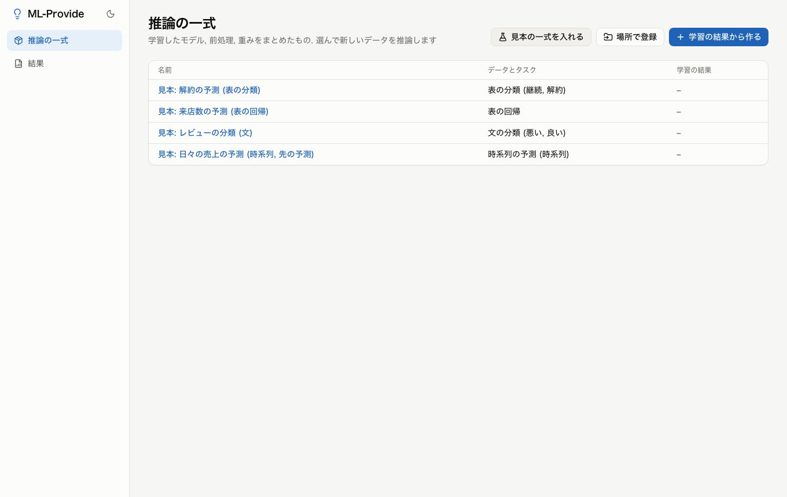
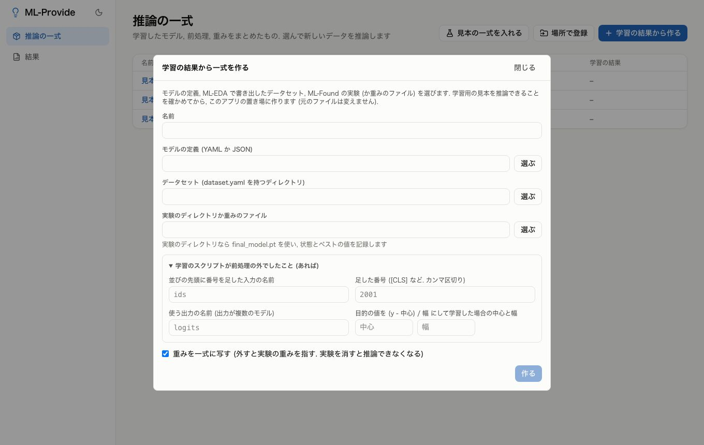
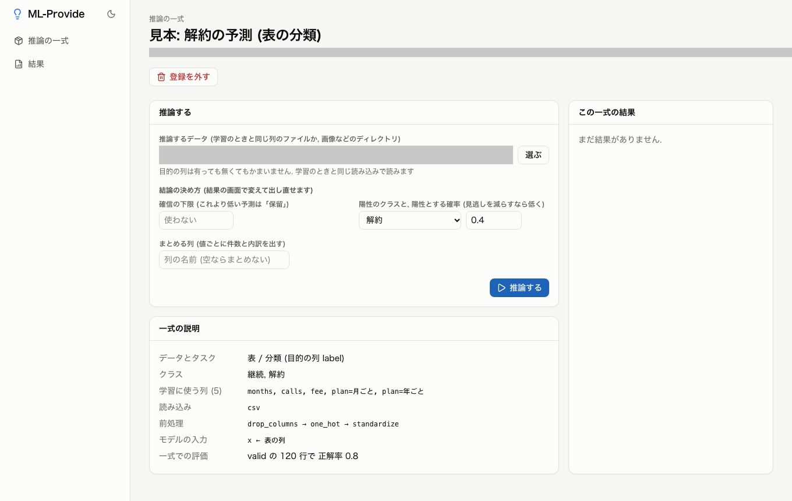
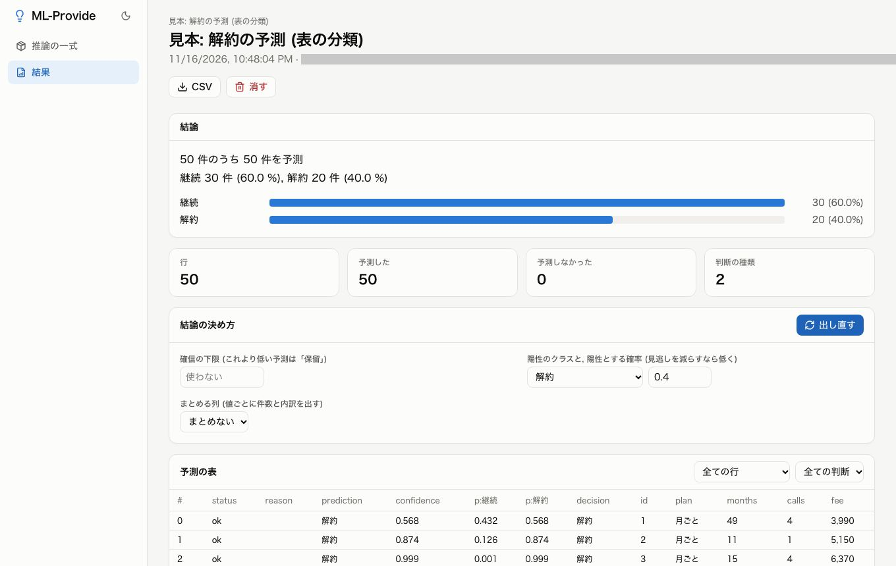
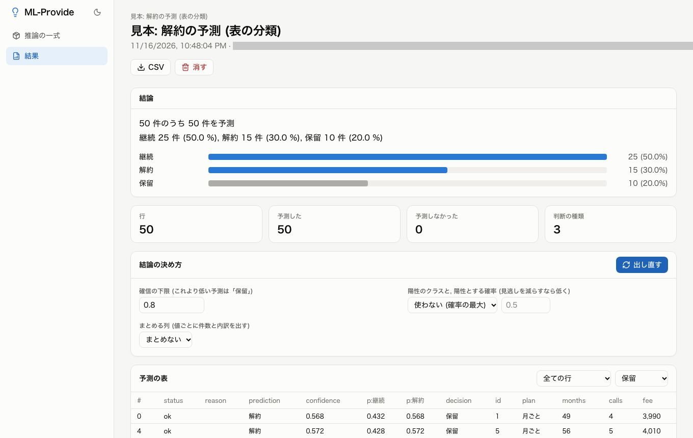
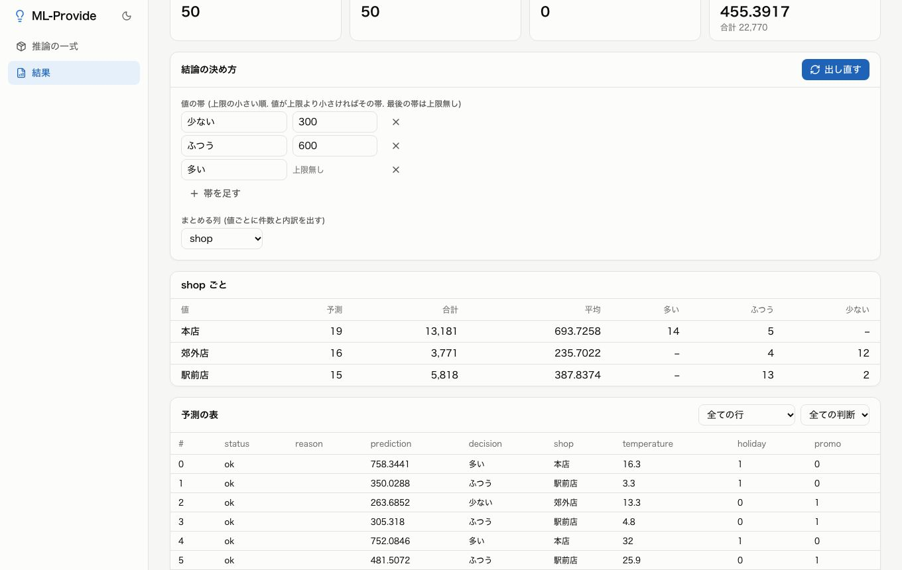
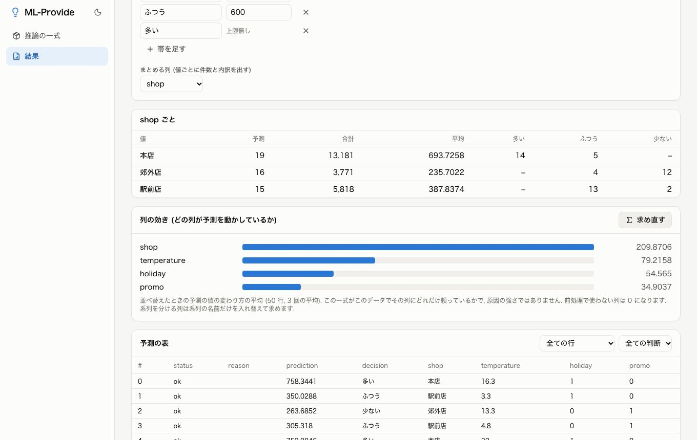

# 操作ガイド

ML-Provide の画面の使い方を, 見本の一式で順に説明する. 起動のしかたは [README](../README.md) の「導入と起動」を参照.

画像の中の手元のパスは, 灰色で伏せている.

## 1. 見本の一式を入れる

「推論の一式」の画面の「見本の一式を入れる」を押すと, 見本のデータで小さなモデルをその場で学習し, 4 つの一式を登録する (5 秒ほど).

| 見本 | データ | 結論の決め方の既定値 |
| --- | --- | --- |
| 解約の予測 (表の分類) | 契約の種類, 利用した月数, 問い合わせの回数, 月額 → 解約か継続 | 「解約」の確率が 0.4 以上なら解約 (見逃しを減らす) |
| 来店数の予測 (表の回帰) | 店, 気温, 休日, 販促 → 来店数 | 300 人と 600 人で 3 つの帯に分け, 店ごとにまとめる |
| 日々の売上の予測 (時系列, 先の予測) | 2 つの店の日々の売上 (前の日と前の週の売上, 曜日) → 次の日の売上 | 店ごとにまとめる. 「何段も先まで予測する」で先の 7 日を予測できる |
| レビューの分類 (文) | 短いレビューの文 → 良いか悪い | 確率が 0.8 より低いものは保留 |

自分の一式を使う場合は, 次のどちらか.

- **学習の結果から作る**: モデルの定義, ML-EDA で書き出したデータセット, ML-Found の実験のディレクトリ (か重みのファイル) を選ぶ. 学習のスクリプトが前処理の外でしたこと (並びの先頭に足した番号, 目的の値の標準化) があれば, 畳んだ欄に書く
- **場所で登録**: 学習のスクリプトが ML-Inference の `make_bundle` で作った一式 (`inference.yaml` を持つディレクトリ. 選ぶ対話では箱の印) を選ぶ

## 2. 推論する

一式の名前を押すと, 一式の画面に移る. 左上が「推論する」, 下が「一式の説明」, 右が「この一式の結果」.

1. 「推論するデータ」に, 学習のときと同じ列のファイル (目的の列は有っても無くてもよい) か, 画像などのディレクトリを選ぶ. 見本の一式は「見本の新しいデータを使う」で, 推論を試すデータが入る (日々の売上の見本は, 2 店の過去の 30 日と売上の空の先の 7 日. 他は目的の列の無い 50 行). 文の一式は「文を書く」で, 1 行に 1 つの文を書いてもよい
2. 「結論の決め方」は一式の既定値が入っている. 変える場合は, 結果の画面でも出し直せる
3. 目的の列の過去の値を使う時系列の一式は「何段も先まで予測する」を選べる. 目的の列が空の先の行を, 予測した値を次の行の過去の値に使いながら系列ごとに順に予測する (結果は先の行だけで, 何段目かを `step` に出す. 先の段ほど誤りが積み重なる. 表の目的の列には予測した値が入る. 列の効きは求めない)
4. 「推論する」を押す

「一式の説明」の「一式での評価」は, 一式を作るときに検証用の分割を一式で推論した値. 実験の記録 (ML-Found の監視した指標のベストの値) と比べられる場合は, 合うかどうかも出る. 合わない場合は画面の上に注意が出る. 学習のスクリプトが前処理の外でしたことを一式に書き忘れると, 形は合っても予測が誤るため (見本の一式は学習の基盤を使わずに作るので, 実験の記録は無い).

## 3. 結果を見る

推論すると結果の画面に移る.

- **結論**: 何件を予測したか, 判断ごとの件数と割合の文と横棒. 予測できなかった行 (前処理の後に欠損がある, 文が空, レシピの手順で除く行など) は「予測なし」になり, 理由は表の `reason` の列に出る
- **数のタイル**: 行の数, 予測した数, 予測しなかった数, 判断の種類 (回帰は予測の平均と合計)
- **予測の表**: 元の列に, `status`, `reason`, `prediction`, `confidence` (分類の, 予測したクラスの確率), `p:<クラス>` (クラスごとの確率), `decision` (判断) を足した表. 予測した行か予測しなかった行か, 判断で絞れる
- 「CSV」で予測と判断の表を保存する (表計算のアプリで開ける BOM 付きの UTF-8)

## 4. 結論の決め方を変えて出し直す

「結論の決め方」を変えて「出し直す」を押すと, 推論し直さずに判断とまとめだけが変わる.

| 決め方 | タスク | 意味 |
| --- | --- | --- |
| 確信の下限 | 分類 | 予測したクラスの確率がこれより低い行を「保留」にする |
| 陽性のクラスと, 陽性とする確率 | 2 クラスの分類 | そのクラスの確率がこの値以上なら, そのクラスにする (見逃しを減らすなら低く). 確信の下限とは一緒に使えない |
| 値の帯 | 回帰, 予測 | 上限の小さい順に名前を付ける. 値が上限より小さければその帯. 最後の帯は上限無し |
| まとめる列 | 全て | 列の値ごとに, 件数と判断の内訳 (回帰は合計と平均も) を表にする |

下は, 解約の見本で陽性のクラスを外し, 確信の下限を 0.8 にして出し直し, 予測の表を「保留」で絞ったところ.

回帰の見本は, 値の帯の内訳と, 店ごとの合計, 平均, 帯の内訳が出る.

## 5. どの列が予測を動かしているか

結果の画面の「列の効き」の「求める」を押すと, 推論したデータの列を 1 つずつ行の間で並べ替えて推論し直し, 予測 (分類は予測したクラスの確率, 回帰は値) がどれだけ動くかを横棒で出す. 正解の無いデータでも求められる (表と時系列のファイルの結果だけ).

下は来店数の見本. 店の水準, 気温, 休日, 販促の順に効いていて, 見本のデータの作り方 (店ごとの水準, 25 度で最も多い気温, 休日 +30 %, 販促 +20 %) と合う.

効きは「この一式がこのデータでその列にどれだけ頼っているか」で, 原因の強さではない. 前処理で使わない列は 0 になる. 並べ替えると予測できなくなる行がある列は, その行の数も出る.

## 6. 結果の一覧

左の「結果」で, 全ての一式の結果を新しい順に見られる. 一式を消しても結果は残る. 結果の画面の「消す」で結果を消す.

## 置き場

既定は `~/.ml-provide/` (環境変数 `ML_PROVIDE_HOME` で変えられる).

- `bundles.json`: 登録した一式
- `bundles/`: 「学習の結果から作る」で作った一式 (一式の画面の「消す」でファイルも消える)
- `samples/`: 見本 (学習用のデータ, データセット, 重み, 一式, 新しいデータ)
- `results/`: 結果 (`predictions.csv` と `result.yaml`)

元のデータ, データセット, 実験のディレクトリは書き換えない.
